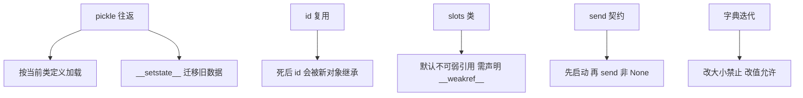

### Q2076 · 迭代期间的字典变更限制

> 难度:★★☆☆☆ | 标签:dict, 迭代, RuntimeError

**问**:for k in d: 里删键为什么报 RuntimeError?改值为什么又可以?

**答**:dict 视图迭代器内置版本号检查:每次推进都比对容器大小,发现「迭代开始后大小变了」就抛 RuntimeError: dictionary changed size during iteration。检测的是大小而非内容,所以迭代中给已有键赋值(同 key 覆盖)不改变大小,是允许的;增删键改变大小,一律禁止。三条安全出路:迭代 list(d) 的键快照(小字典直接,大字典有 O(n) 快照成本);先收集待删键再统一删,即「两步法」;或者构造新字典做不可变替换。set 更严格,没有「改值」逃生通道,迭代期间任何结构变更都可能出事。

```python
# file: code/01_语言核心与底层/q2076_dict_mutation.py
"""迭代期间的字典变更限制:改值可以,改大小不行。"""


def safe_delete_snapshot(prices):
    deleted = []
    for key in list(prices):       # 先物化键快照再删
        if prices[key] <= 0:
            deleted.append(key)
            del prices[key]
    return deleted


def safe_delete_deferred(prices):
    doomed = [k for k, v in prices.items() if v <= 0]
    for k in doomed:               # 收集完再统一删
        del prices[k]
    return doomed


if __name__ == "__main__":
    prices = {"a": 10, "b": 0, "c": 5, "d": -1}
    try:
        for k in prices:
            if prices[k] <= 0:
                del prices[k]      # 迭代中改变大小
    except RuntimeError as e:
        print("迭代中删键:", e)

    prices = {"a": 10, "b": 0, "c": 5, "d": -1}
    for k in prices:
        prices[k] = 99             # 只覆盖值,大小不变
    print("迭代中改值:允许 ->", prices)

    p1 = {"a": 10, "b": 0, "c": 5, "d": -1}
    print("快照法:", safe_delete_snapshot(p1), "->", p1)
    p2 = {"a": 10, "b": 0, "c": 5, "d": -1}
    print("两步法:", safe_delete_deferred(p2), "->", p2)
```

**追问**:1) 为什么覆盖值不报错?——迭代协议只检测容器大小,同键覆盖不改变桶数量;set 迭代中能改吗?——不能,任何增删都可能触发同样的 RuntimeError,连覆盖的余地都没有。2) 检测机制?——迭代器每步比对 dict 的已用槽位数,变化即 RuntimeError("dictionary changed size during iteration");这是「迭代期间结构变更」的防护,不是事务隔离。3) 安全遍历姿势?——list(d) 快照后遍历快照;或 dict.copy() 后改副本;并发场景加锁而不是靠「碰运气不崩」。4) 生产陷阱?——遍历中删键(最常见);依赖「覆盖不报错」的实现细节;多线程无锁并发读写 dict 在迭代路径上偶发崩。


