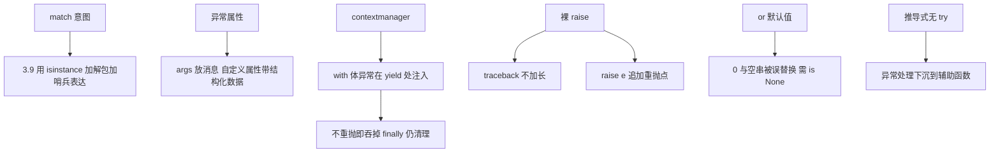

### Q2083 · 推导式里没有 try:异常安全的推导写法

> 难度:★★★☆☆ | 标签:推导式, 异常, EAFP

**问**:推导式是表达式,写不了 try/except,那对「可能失败的元素」怎么优雅地推导?

**答**:语法限制的根源:推导式整体是一个表达式,体内只能放表达式,而 try 是语句。等价解法有三:把失败处理下沉到辅助函数——函数体内随便写 try,推导式只管调用,「一个坏元素报废整批」就变成「坏元素得 None」;前置过滤——能判定合法性就先 if x > 0 过滤,LBYL 把异常路径挡在门外;map 加辅助函数,效果与第一种相同。选择原则:坏元素是预期内情况用辅助函数转 None 或跳过,坏元素说明上游有 bug 就让它当场炸掉,fail-fast 别掩盖(见 Q1559 的两种收场)。

```python
# file: code/01_语言核心与底层/q2083_comprehension_try.py
"""推导式里不能写 try:把异常处理下沉到辅助函数。"""
import math


def safe_log(value):
    """非法输入统一表达为 None,不炸整批。"""
    try:
        return round(math.log(value), 3)
    except ValueError:
        return None


if __name__ == "__main__":
    xs = [1, math.e, 0, -2, math.e ** 2]
    print("输入:", xs)
    print("辅助函数版:", [safe_log(x) for x in xs])
    print("前置过滤版:", [round(math.log(x), 3) for x in xs if x > 0])

    try:
        [math.log(x) for x in xs]
    except ValueError as e:
        print("裸推导整批报废:", e)
```

**追问**:1) walrus 能解决吗?——不能,它只是表达式赋值,依旧装不下 try 语句;辅助函数有性能代价吗?——每元素一次调用,热路径可先过滤再推导,让异常路径变冷路径。2) 异常安全推导的三种写法?——辅助函数 safe_parse(x) 包 try 返回 None + 外层 if 过滤;先 filter(可解析项) 再推导;map+过滤组合;共同点是「异常处理出推导式,表达式内只留纯逻辑」。3) 与「过滤」语义的取舍?——try 推导常伴「跳过坏数据」,跳过策略要显式(丢弃/记日志/聚合统计),不能静默;丢弃比例要有监控。4) 生产陷阱?——推导式里想塞 try 写不出来被迫嵌套循环;静默丢坏数据无日志;过滤+推导两次遍历在大数据上的成本(可合并为生成器)。


