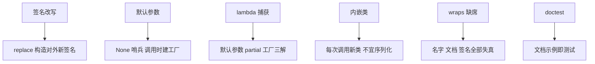

### Q2092 · lambda 的边界:什么时候必须用 def

> 难度:★★★☆☆ | 标签:lambda, def, 可读性

**问**:lambda 除了「只能写一个表达式」还缺什么?哪些场景必须退回 def?

**答**:lambda 是纯表达式语法,五件事做不了:多条语句与控制流(没有 try、while、赋值语句);递归——没有名字可自引用,靠全局名硬凑依赖解析时机,重绑定即炸;类型注解与 docstring,语法位不存在;清晰的调试名——栈帧里永远是 <lambda>,排查链路时定位成本高(实测 traceback 中只见 <lambda>)。适用边界因此清晰:排序 key、map/filter 的短小纯转换、字典分派的简单值,一行能读完的用 lambda;超过一行、要复用、要注解、可能进 traceback 的,一律 def。可读性判据也简单:读者不用在脑子里展开表达式就能懂,才配用 lambda。

```python
# file: code/01_语言核心与底层/q2092_lambda_limits.py
"""lambda 的边界:语句、递归、注解与调试名的缺失。"""
import traceback


def fib_def(n):
    """def 有名字:可递归、可写 docstring 与注解。"""
    return n if n < 2 else fib_def(n - 1) + fib_def(n - 2)


def boom():
    raise ValueError("deep error")


if __name__ == "__main__":
    square = lambda x: x * x
    print("单表达式可用:", square(6))
    print("调试名缺失:", square.__name__, "| def 有名:", fib_def.__name__)
    print("def 递归:", fib_def(10))

    caller = lambda: boom()
    try:
        caller()
    except ValueError:
        tb = traceback.format_exc()
        print("栈帧里只显示 <lambda>:", "<lambda>" in tb)

    print("结论:要语句、递归、注解、docstring 或清晰栈帧时,用 def")
```

**追问**:1) lambda 真的不能有注解吗?——语法不支持,注解只有 def 形式;排序 key 用 lambda 还是 itemgetter?——单字段几乎等价,多字段与纯 C 路径用 itemgetter 更快,见 Q514。2) 必须用 def 的场景?——多语句逻辑、类型注解、docstring、递归自引用、需要 __name__ 的回调注册;lambda 只做单表达式。3) lambda 的工程边界?——key 函数、默认值工厂、高阶函数实参是正当用途;赋值给变量(lambda 语句)PEP8 都不建议——直接 def。4) 生产陷阱?——lambda 塞复杂逻辑可读性崩;__name__ 是 <lambda> 让监控聚合失效(Q547);该 itemgetter 的多字段排序用 lambda 多一层函数调用。


