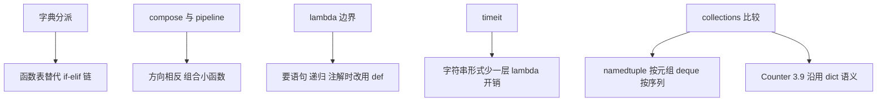

### Q2094 · collections 容器的比较语义

> 难度:★★★☆☆ | 标签:collections, 比较语义, 版本差异

**问**:namedtuple、deque、Counter 的 == 各自按什么规则比?有什么版本坑?

**答**:三个容器三套规则。namedtuple 继承 tuple 的相等性:按位置逐元素比,**字段名与类型不参与**——Point(1, 2) == Vec(1, 2) == (1, 2) 全为 True,这是「结构相等」的取舍,要类型敏感得自己写 __eq__ 先比 type。deque 按序列内容比较,但类型门禁存在:deque([1,2,3]) == [1,2,3] 是 False。Counter 在 3.9 沿用 dict 语义,零计数条目参与比较——Counter(a=2, b=0) != Counter(a=2),与普通 dict 比也不等;3.10 起才把缺失视为零计数并补齐 <、<= 等多重集合比较,demo 用版本守卫展示了两种行为。跨版本库代码里对 Counter 做相等判断前,先想清楚要的是 dict 语义还是多重集语义。

```python
# file: code/01_语言核心与底层/q2094_collections_compare.py
"""collections 容器的比较语义:namedtuple、deque 与 Counter。"""
import collections
import sys

Point = collections.namedtuple("Point", ["x", "y"])
Vec = collections.namedtuple("Vec", ["x", "y"])


if __name__ == "__main__":
    print("namedtuple 按元组比较,字段名不参与:", Point(1, 2) == Vec(1, 2) == (1, 2))
    print("位置参与比较:", Point(1, 2) == Point(2, 1))

    d1 = collections.deque([1, 2, 3])
    d2 = collections.deque([1, 2, 3])
    print("deque 与 deque:", d1 == d2, "| deque 与 list:", d1 == [1, 2, 3])

    c1 = collections.Counter(a=2, b=0)
    c2 = collections.Counter(a=2)
    print("3.9 的 Counter 沿用 dict 语义,零计数参与:", c1 == c2, "|", c1 == {"a": 2})

    if sys.version_info >= (3, 10):
        print("3.10+ 缺失视为零计数:", c1 == c2,
              "| 多重集合比较:", collections.Counter(a=1) <= collections.Counter(a=1, b=2))
    else:
        try:
            c1 < c2
        except TypeError:
            print("3.9 没有 Counter 的 < 比较:TypeError,3.10 才补齐")
```

**追问**:1) 为什么 namedtuple 不按类型比较?——它直接继承 tuple 相等性,类型只是工厂产物;想要类型敏感怎么办?——自定义 __eq__ 先比对 type 再比字段,别指望 dataclass 自动带上。2) 各容器的比较语义?——dict/Counter 按「键值多重集」相等(顺序无关);list/tuple 按位置;frozenset 按集合;Counter(1,2)==Counter(2,1) 为 True(multiset 语义)。3) 类型不敏感的放大效应?——Point(1,2) == (1,2) 为 True 让「类型收窄」失效;跨类型相等混入 set/dict 造成隐性覆盖(Q539 的 True/1 同源问题)。4) 生产陷阱?——期望 dataclass 实例只与同类比较(默认不查 type);Counter 与 dict 互比;比较语义没写进文档。


