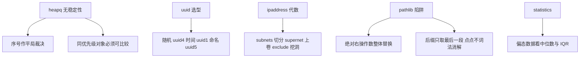

### Q2099 · statistics:均值、中位数与分位数的选型

> 难度:★★☆☆☆ | 标签:statistics, 统计, 数据分析

**问**:mean 和 median 差在哪?描述一组建材数据该选哪几个统计量?

**答**:均值对极端值零抵抗——demo 里 10 个人的薪资混进一个 190000,均值从 4000 量级被抬到 2 万开外,中位数纹丝不动;偏态分布(薪资、延迟、耗时)报中位数,对称分布两者趋同才可放心用 mean。fmean 是 3.8+ 的单遍 float 求和,更快,大样本统计优先。分位数用 quantiles(n=4) 拿四分位切点,IQR(四分位距)是稳健的离散度量,配合「超出 1.5 倍 IQR 即离群」的经验规则就是最小可用的异常检测。标准差分两种口径:stdev 是样本口径(除以 n-1),pstdev 是总体口径,抽样数据用前者,demo 一并对照。

```python
# file: code/01_语言核心与底层/q2099_statistics_choice.py
"""statistics:均值、中位数与分位数在偏态数据上的分工。"""
import statistics

salaries = [3000, 3200, 3500, 3800, 4000, 4200, 4500, 4800, 5000, 190000]


if __name__ == "__main__":
    print("均值被极端值抬高:", round(statistics.mean(salaries), 1))
    print("中位数稳健:", statistics.median(salaries))
    print("fmean 更快返回 float:", round(statistics.fmean(salaries), 1))

    q = statistics.quantiles(salaries, n=4)
    print("四分位切点:", [round(v, 1) for v in q])
    print("四分位距 IQR:", round(q[2] - q[0], 1))

    small = [1, 2, 2, 3]
    print("众数:", statistics.mode(small),
          "| 样本标准差:", round(statistics.stdev(small), 3),
          "| 总体标准差:", round(statistics.pstdev(small), 3))
```

**追问**:1) mean 与 fmean 的差别?——fmean 单遍 float 求和更快,精度口径与 mean 略异,大样本优先;quantiles 的口径差异?——exclusive 与 inclusive 两种分位约定,跨语言对数时必须对齐口径。2) 选型矩阵?——mean/Fraction 精度、fmean 性能;median/quantiles 偶数位平均规则;pstdev/variance 注意 n>=2(单样本抛 StatisticsError)。3) 口径对齐?——quantiles(n=4, method="inclusive") 对齐多数 BI 工具;Excel PERCENTILE 与 Python 口径不一致是经典对数灾难。4) 生产陷阱?——跨系统分位数对不上(口径);大数吃小数(改 fmean/Decimal,Q537);单样本 variance 崩;nan 混入直接传染。


