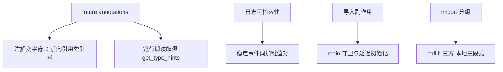

### Q2105 · 日志消息的可检索性规范

> 难度:★★★☆☆ | 标签:logging, 可观测性, 规范

**问**:怎么写日志消息,才能让 grep、告警规则与聚合系统各取所需?

**答**:核心是让日志行有**稳定的检索锚点**:消息以大写事件词开头(如 PAY_RETRY、PAY_OK),全团队唯一、永不改拼写,grep 事件词就能拉全同类日志;字段用 key=value 平铺(order=1001 attempt=2),人可读、机器可正则提取,还能演进成结构化日志。三条反模式:f-string 拼接日志消息(字段在打日志前就求值,聚合器无法按字段过滤,还违背延迟格式化,见 Q503);一条消息里塞多个事件语义(拆成多条,每条一个事件词);级别语义漂移——ERROR 必须是需要人介入的,WARNING 是自愈但异常,INFO 是业务里程碑,DEBUG 只进开发,级别一旦当流量阀门用就废了。

```python
# file: code/01_语言核心与底层/q2105_log_grep.py
"""日志消息的可检索性规范:稳定事件词、键值对与级别语义。"""
import io
import logging


def make_logger(name):
    buf = io.StringIO()
    handler = logging.StreamHandler(buf)
    handler.setFormatter(logging.Formatter("%(levelname)s %(name)s %(message)s"))
    log = logging.getLogger(name)
    log.handlers = [handler]
    log.propagate = False
    log.setLevel(logging.INFO)
    return log, buf


if __name__ == "__main__":
    log, buf = make_logger("pay")

    log.warning("PAY_RETRY attempt=2 order=1001 delay=0.5s")   # 事件词 + 键值对
    log.info("PAY_OK order=1001 amount=99.0")
    log.error(f"PAY_FAIL order={1002} reason=timeout")          # 反例:f-string 提前求值

    for line in buf.getvalue().splitlines():
        print(line)
    print("grep PAY_ 全命中,grep attempt= 精确定位;f-string 版本无法按字段过滤")
```

**追问**:1) 键值对与 logging 的 extra 什么关系?——extra 进 %(key)s 格式化供结构化提取,message 里的 key=value 是给人 grep 的轻量折中;级别语义怎么落地?——写成团队文档并用 linter 或评审守住,ERROR 必须可告警。2) 可检索性的规范要点?——消息模板稳定(参数化,不拼接);关键标识(user_id/trace_id)进消息或 extra;单位写进字段名(duration_ms);ERROR/WARN 语义分级。3) 与结构化日志的演进?——json formatter 读 extra/record 属性;message 仍保留人类可读摘要;grep 与查询双通道。4) 生产陷阱?——消息拼接动态值导致模板漂移无法聚合;ERROR 滥用告警疲劳;PII/密钥进日志;级别与真实严重性错位。


