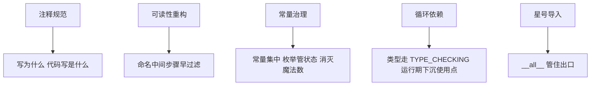

### Q2110 · 常量治理:模块常量、枚举与配置的边界

> 难度:★★★☆☆ | 标签:常量, Enum, 魔法数

**问**:代码里的「3」「30」「86400」该怎么管?常量、枚举、配置的边界在哪?

**答**:治理路径是三级:魔法数先提名为模块级大写常量(MAX_RETRY = 3),命名即文档、含义单点维护;封闭集合的状态用 Enum——demo 的 OrderState 让非法状态在构造期就被拒绝,配合状态转移表(frozenset 邻接表)把「能不能从 A 到 B」变成数据而非 if 链(枚举工程用法见 Q512);会随部署环境变的值走配置(环境变量,见 Q521),代码里只留默认值。边界判据一句话:代码结构性的进常量、封闭语义的进枚举、部署相关的进配置——让「改它需要发版」还是「改它需要改配置」成为显式决策。附带收益:parse_state 把 ValueError 翻译成带上下文的业务错误,非法输入的报错也从「裸异常」升级为「可定位信息」。

```python
# file: code/01_语言核心与底层/q2110_constants_governance.py
"""常量治理:模块常量、Enum 与魔法数的边界。"""
import enum


class OrderState(enum.Enum):
    CREATED = "created"
    PAID = "paid"
    SHIPPED = "shipped"


MAX_RETRY = 3                     # 模块级常量:大写 + 下划线
TIMEOUT_SECONDS = 30

_ALLOWED_NEXT = {
    OrderState.CREATED: frozenset({OrderState.PAID}),
    OrderState.PAID: frozenset({OrderState.SHIPPED}),
    OrderState.SHIPPED: frozenset(),
}


def can_transition(src, dst):
    return dst in _ALLOWED_NEXT.get(src, frozenset())


def parse_state(raw):
    try:
        return OrderState(raw)
    except ValueError:
        raise ValueError(f"未知订单状态: {raw!r}") from None


if __name__ == "__main__":
    print("合法推进:", can_transition(OrderState.PAID, OrderState.SHIPPED))
    print("非法跳转:", can_transition(OrderState.CREATED, OrderState.SHIPPED))
    print("字符串解析:", parse_state("paid"))
    try:
        parse_state("cancelled")
    except ValueError as e:
        print("带上下文的报错:", e)
    print("魔法数消失后:含义集中在唯一的常量与枚举定义处")
```

**追问**:1) 枚举与常量怎么分工?——封闭集合且要防非法值用 Enum,散点数值常量用大写模块常量;配置和常量的边界?——部署可变的走配置,代码结构性的走常量,别让配置冒充常量也别反了。2) 治理的完整框架?——魔法数字收进命名常量;封闭语义集进 Enum(防非法值,Q512);跨环境可变项进配置对象(冻结,Q1279);三类之间不越界。3) 常量的测试价值?——常量集中让「阈值调整」单一来源;Enum 让穷尽性检查(assert_never)生效(Q1274);配置冒充常量的信号是「测试要改配置才过」。4) 生产陷阱?——同一常量多处定义漂移;枚举值与数据库/协议漂移;把部署可变项硬编码成常量(改值要发版)。


