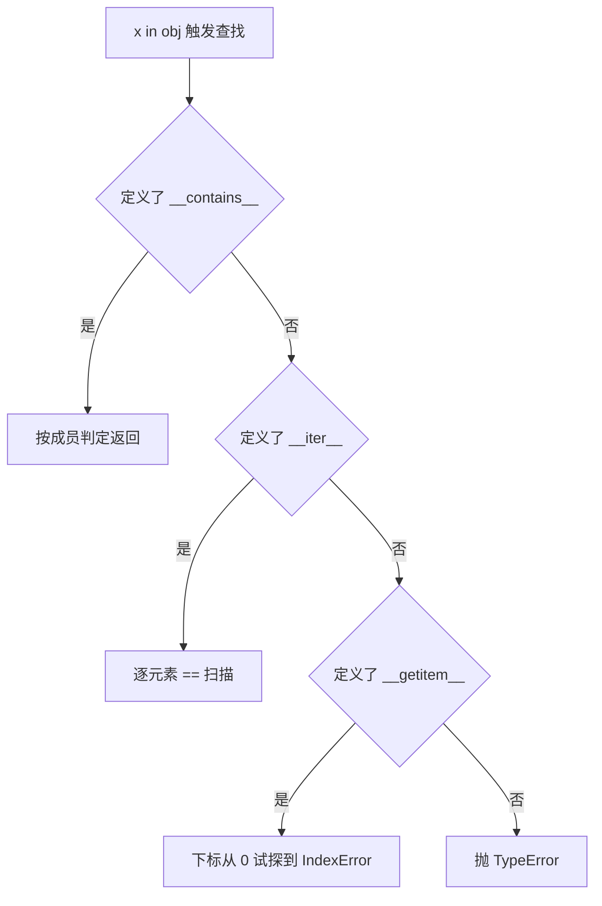

### Q2340 · id() 的生命周期陷阱:临时对象与地址复用

> 难度:★★★★☆ | 标签:id, 对象生命周期, CPython

**问**:为什么 `id(f()) == id(f())` 可能返回 True?id() 的结果什么时候还有效?

**答**:id() 返回的是「对象存活期间」的唯一标识,CPython 里恰好是内存地址;一旦对象被回收,它的 id 就作废,同一块内存可以立刻分给新对象,新对象的 id 与旧对象相同。于是 `id(f()) == id(f())` 这种比较毫无意义:第一个临时对象在比较前就可能被回收,第二个临时对象复用了同一地址,结果恒为 True 但说明不了任何问题。规矩有三条:身份比较必须基于同时存活的对象;跨语句比较身份,先把引用存进变量;想让「键在对象死后自动消失」,用 WeakValueDictionary 这类弱引用结构,而不是拿 id 当 key。is 的误用同理——对临时表达式做 is 比较是在赌垃圾回收的时机。

```python
# file: code/01_语言核心与底层/q2340_id_lifetime.py
"""id() 的生命周期陷阱:表达式结束后对象即可回收,地址可被复用。"""
import gc
import weakref


class Box:
    def __init__(self, tag):
        self.tag = tag


if __name__ == "__main__":
    id1 = id(Box("a"))
    id2 = id(Box("b"))
    print("两个临时对象的 id 相等:", id1 == id2)   # 地址复用,True 但无意义

    x = Box("keep")
    y = x
    print("同时存活的别名 is 判断可靠:", x is y)

    b1 = Box("first")
    b2 = Box("second")
    print("持有引用后 id 必不相同:", id(b1) != id(b2))

    cache = weakref.WeakValueDictionary()
    cache["first"] = b1
    print("弱引用取回同一对象:", cache["first"] is b1)
    del b1
    gc.collect()
    print("引用消失后弱引用自动清理:", "first" not in cache)
```

**追问**:1) 那 CPython 里两次 `id(Box())` 为什么几乎总是相等?——CPython 用引用计数,表达式求值完临时对象计数归零立刻释放,下一对象分配到同一块内存;这不是语言保证,换实现或开 debug 钩子都可能不同。2) 生命周期陷阱的完整形态?——临时对象求值完即死,id 立即可复用;持有 id 值做索引(跨对象比较)是错误;存活期内 id 稳定、之外无意义(Q2073)。3) 正确的「存活期唯一」需求?——直接持有对象引用做 key(默认哈希即身份);WeakKeyDictionary 让身份索引随死亡清理(Q2073)。4) 生产陷阱?——两次 id() 相等的实验被当成语义;id 进业务数据/日志跨进程比较;调试「幽灵命中」要想起地址复用。


