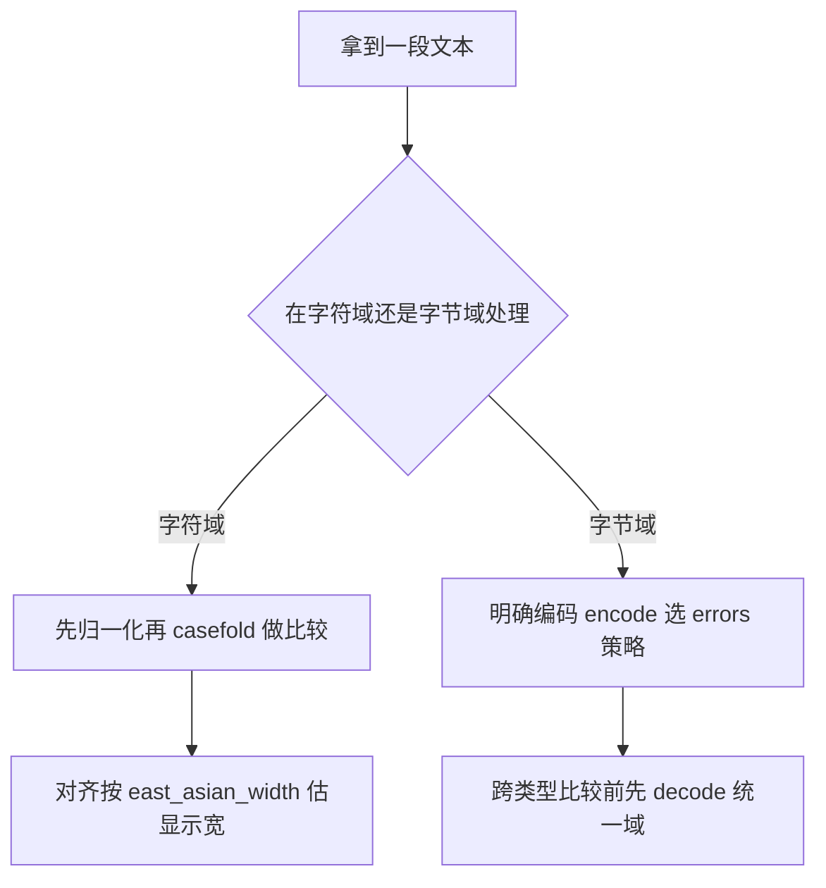

### Q2346 · casefold 与 lower:大小写折叠的边界

> 难度:★★☆☆☆ | 标签:casefold, 大小写, 国际化

**问**:做大小写无关的匹配,为什么推荐 casefold 而不是 lower?

**答**:lower 做的是「单字符小写化」,casefold 做的是「为无差别比较而折叠」,后者会把某些字符展开成多个字符:德语 ß 折叠成 ss(而 lower 保留 ß),希腊语最终形西格玛也归一为普通形。因此判断「两个词是否同一词(忽略大小写)」时,casefold 的覆盖面更完整,尤其对德语等语言,lower 会漏判。还有一个细节:土耳其语 İ(带点大写 I)casefold 后是 i 加组合点,长度变了——所以 casefold 的结果不能再当等长字符串用,但作 dict 键、in 匹配完全没问题。工程惯例:构建大小写无关的索引或查表时,统一「入口 casefold、存键 casefold」,两侧口径一致才不会漏。内部标识符、ASCII 为主的数据用 lower 足够,面向用户文本的匹配一律 casefold。

```python
# file: code/01_语言核心与底层/q2346_casefold.py
"""casefold 与 lower:大小写折叠的边界差异与查表惯例。"""

if __name__ == "__main__":
    samples = ["HELLO", "Straße", "ΣΊΣΥΦΟΣ", "İstanbul"]
    for s in samples:
        print(f"{s!r:>12} lower={s.lower()!r} casefold={s.casefold()!r}")

    print("ß 折叠一致:", "straße".casefold() == "strasse".casefold())
    print("lower 会漏判:", "straße".lower() == "strasse".lower())

    known = {"strasse": "德国公路"}
    query = "STRASSE"
    print("casefold 查表:", known.get(query.casefold()))
```

**追问**:1) casefold 和 normalize 是什么关系?——互补的两步:normalize(NFKC) 处理「长得一样但码点不同」(如全角),casefold 处理「大小写变体」,严格的无差别比较两者都要做。2) casefold 与 lower 的差异?——casefold 是语言级折叠(ß→ss),lower 是逐字符映射;德语/希腊语等场景 lower 会漏;casefold 结果通常更长。3) 无差别比较的完整管线?——NFC 归一 → casefold → 比较;入口归一化一次存库(Q491),比较前再 casefold;translate 只能做字符级 1:1(Q1538)管不了多字符折叠。4) 生产陷阱?——用 lower 做德语文本去重漏 ß;只 casefold 不 normalize(全角漏);折叠后的字符串直接回写业务数据(改变原语义)。


