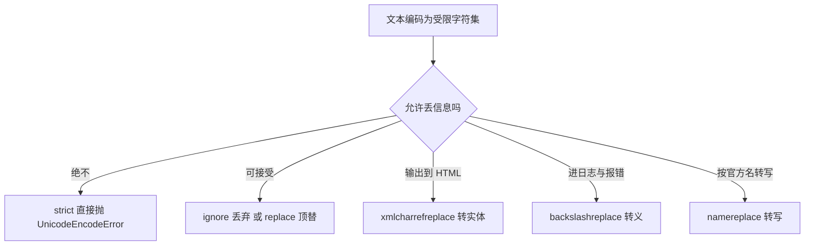

### Q2351 · 宽字符与显示宽度:len 之外的列宽

> 难度:★★★★☆ | 标签:Unicode, 显示宽度, 东亚字符

**问**:为什么 "中文" 的 len 是 2,终端里却占了 4 列?对齐表格该怎么补空格?

**答**:len 数的是码点个数,而终端列宽由字体的「东亚宽度」属性决定:汉字与全角假名属于 F/W(全角/宽),占 2 列;ASCII 与大多数西文字符占 1 列。标准库 `unicodedata.east_asian_width` 返回每个字符的宽度类别,自算显示宽就是「宽字符记 2、其余记 1」(组合字符记 0)。更隐蔽的是组合字符:é 可以是一个码点(U+00E9)也可以是 e 加组合锐音符两个码点,len 不一样,但显示宽度一样——所以对齐前常先 normalize(NFC) 归一。用 len 做定宽表格的对齐,中文内容一多就错位,这正是按显示宽补空格的动机;真正的终端表格场景应交给 wcwidth 这类第三方库,标准库方案适合「自算+已知字符集」的受控环境。这个知识点在国际化 UI、CLI 输出、日志对齐里都是必备。

```python
# file: code/01_语言核心与底层/q2351_display_width.py
"""len 是字符数不是显示宽度:东亚宽度与组合字符。"""
import unicodedata


def display_width(s):
    """宽字符记 2、组合字符记 0、其余记 1 的终端列宽估算。"""
    total = 0
    for ch in s:
        if unicodedata.combining(ch):
            continue
        total += 2 if unicodedata.east_asian_width(ch) in ("F", "W") else 1
    return total


if __name__ == "__main__":
    samples = ["abc", "中文", "ａｂｃ", "naïve", "éclair"]
    for s in samples:
        print(f"{s!r:<12} len={len(s)} 显示宽={display_width(s)}")

    nfc = "é"
    nfd = "e\u0301"
    print("NFC len:", len(nfc), "| NFD len:", len(nfd))
    print("显示宽相同:", display_width(nfc) == display_width(nfd))
    print("归一化后相等:", unicodedata.normalize("NFC", nfd) == nfc)

    rows = [("名称", "值"), ("name", "value")]
    width = max(display_width(r[0]) for r in rows)
    for name, val in rows:
        print(name + " " * (width - display_width(name)) + " | " + val)
```

**追问**:1) emoji 的宽度怎么算?——多数 emoji 是 W 宽度但占 2 列以上,还有 ZWJ 序列拼成的复合 emoji,len、east_asian_width 都算不准,必须用 wcwidth 类库并按版本维护宽度表。2) 显示宽度的机制?——east_asian_width 分 W/F(2)/Na/N/H(1)/A(依环境);终端渲染还受字体影响;len 是码点数不是列宽(Q1540)。3) 工程处理?——表格对齐用 wcwidth.wcswidth 逐列算;不等宽列用分隔符而不是空格对齐;日志格式截断也按显示宽。4) 生产陷阱?——CJK/emoji 让表格错位;组合字符(零宽)算进 len;把「码点数」当「用户可见长度」做限长校验。


