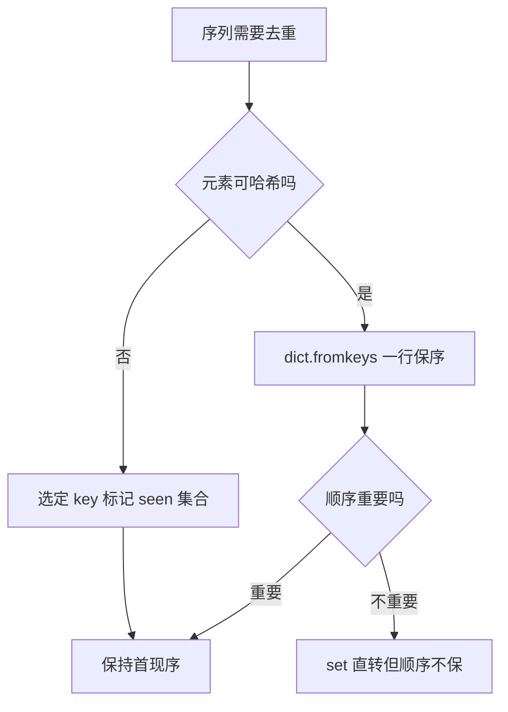

### Q2358 · 递归相等与循环引用:身份短路的边界

> 难度:★★★☆☆ | 标签:相等性, 循环引用, 递归

**问**:一个列表把自身作为元素,l == l 还能正常返回吗?两个独立构建的循环结构比较会怎样?

**答**:容器 == 的逐元素递归遇上循环引用,靠「身份短路」保命:正在比较的两个对象若完全相同(同一对象出现在两侧),直接判等,不再下钻,所以 l == l 恒为 True,哪怕 l 自引用。但短路只对「同一对象」生效:两个独立构建的循环结构 x = [1, x] 与 y = [1, y] 比较,x[1] 与 y[1] 不是同一对对象,继续下钻又是 x vs y 这一对——CPython 没有已比较对的记忆表,直接递归到 RecursionError,实测 3.9 就是这样。这个知识点的工程意义:自定义树/图结构的 __eq__ 时,不要指望 == 兜底,要么先比身份再比值,要么自己维护「已比较对」集合做记忆化;序列化前也应该检测并打断循环引用。

```python
# file: code/01_语言核心与底层/q2358_recursive_eq.py
"""== 的递归相等与循环引用:身份短路何时救场,何时失效。"""

if __name__ == "__main__":
    a = [1, [2, 3]]
    b = [1, [2, 3]]
    print("深嵌套逐元素比较:", a == b)

    a.append(a)
    print("自引用对象与自身比较:", a == a)     # 身份短路

    x = [1]
    x.append(x)
    y = [1]
    y.append(y)
    try:
        print(x == y)
    except RecursionError:
        print("两个独立循环结构: RecursionError,递归不收敛")

    other = [1, [1]]
    print("循环 vs 手工展开:", x == other)
```

**追问**:1) json.dumps 序列化循环引用会怎样?——抛 ValueError: Circular reference detected,标准 json 编码器有检测;自定义递归比较器应参考同样的思路维护 seen 集合。2) 身份短路的边界?——相等递归靠「同一对象直接 True」短路;一旦绕过(自建对象包装),递归比较会无限展开;seen 集合(id 或对象引用)是通用防护。3) 循环引用的正常来源?——父/子双向引用、缓存对象回指容器、单例互相持有;正确建模不靠「打破相等」,靠显式 seen 或放弃全等比较改语义等价。4) 生产陷阱?——自写 __eq__ 递归无 seen 死栈;deepcopy/序列化对环的处理差异(pickle 支持环,json 不支持);把含环对象放进需要哈希的结构。


