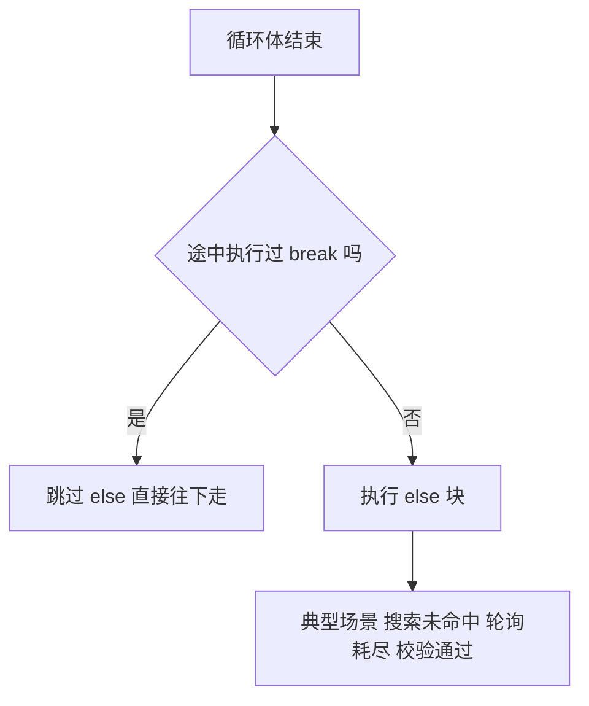

### Q2364 · 循环 else 三种语义再辨析

> 难度:★★★☆☆ | 标签:for-else, while-else, 控制流

**问**:for-else 的 else 到底什么时候执行?它和「循环出错」「循环没执行」有关系吗?

**答**:循环 else 的唯一规则:循环体自然结束(没遇到 break)就执行 else;遇到 break 就跳过。三个误区逐一排除——它不表示「循环出错」(与异常无关);不要求循环体执行过(空序列同样进 else,这恰好是「没找到」语义的一部分);与 continue 无关(continue 只是跳过本轮,不影响 else 的触发)。它真正的价值是把「搜索未命中」「轮询耗尽」「校验通过才继续」这类收尾逻辑放进语法结构,替代 flags 变量:found = False; for ...: if ...: found = True; if not found: ... 的四行变两行。可读性争议一直存在,官方命名 searched/checked 更贴切;团队约定通常是:能用 in、any、next(iter, 默认值) 表达的就用函数式写法,确需 flags 时才用 else。

```python
# file: code/01_语言核心与底层/q2364_loop_else.py
"""循环 else 再辨析:没遇到 break 才执行,continue 与空序列都不影响。"""


def find(items, target):
    """for-else:找完没 break 走 else,天然表达未找到。"""
    for item in items:
        if item == target:
            return f"找到 {target}"
    else:
        return "遍历结束未找到"


def poll(max_attempts, succeed_at):
    """while-else:重试耗尽仍未成功,进 else 收场。"""
    attempts = 0
    while attempts < max_attempts:
        attempts += 1
        if attempts == 2:
            continue                # continue 不影响 else
        if attempts == succeed_at:
            break                   # 只有 break 跳过 else
    else:
        return f"重试 {max_attempts} 次仍未成功"
    return f"第 {attempts} 次成功"


if __name__ == "__main__":
    print(find([1, 2, 3], 3))
    print(find([1, 2, 3], 9))
    print(poll(5, 3))
    print(poll(5, 9))

    for _ in []:
        pass
    else:
        print("空序列同样进 else")

    for n in range(3):
        if n == 9:
            break
    else:
        print("没 break 就进 else,与异常无关")

    names = ["a", "b"]
    print("函数式替代:", "b" in names and "找到 b" or "未找到")
```

**追问**:1) try-else 和循环 else 是同一类设计吗?——同源:「else = 没有发生中断时的收尾」,try-else 是无异常、循环 else 是无 break,把「正常路径」与「防御路径」分离的思想一致。2) 三种 else 的对照表?——循环 else:nobreak;try-else:try 无异常;真值场景没有 else 惯用法(if-else 是分支不是收尾)——统一心智是「中断的否决权在中断者手里」。3) 可读性策略?——else 前注释语义(nobreak / no-exception);团队约定优先于个人风格;混乱场景退化为 flag 变量。4) 生产陷阱?——清理逻辑误入 else 被 break/异常跳过(Q518);三种 else 混读;while-else 轮询场景 return 与 else 的组合顺序(Q1526)。


