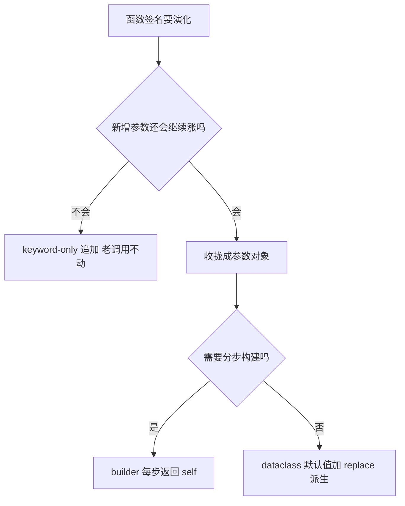

### Q2368 · 递归深度控制与显式栈转换

> 难度:★★★★☆ | 标签:递归, RecursionError, 显式栈

**问**:sys.setrecursionlimit 调大就安全吗?深递归的标准出路是什么?

**答**:递归上限默认 1000,setrecursionlimit 能调大,但它只是「Python 帧的数量上限」,真正的硬约束是 C 栈:每层递归都消耗真实栈内存,上限设太大(几万以上)可能直接段错误崩溃,连 RecursionError 都没有——所以调上限只是权宜之计,还要配合 threading.stack_size 给专用线程更大的栈。正解是结构性的:线性深度的递归(链表、深嵌套 JSON、递归下降解析)改显式栈迭代,用 list 模拟调用栈,pop 代替递归进入、push 代替递归返回,深度只受堆内存限制;树形递归天然 log 深度,保持递归即可。区分这两种形态是面试考点:demo 里 1500 深的链式结构递归版爆炸、显式栈版轻松跑过。另外注意:递归深度超限抛的是 RecursionError(RuntimeError 子类),在 except 里再做事也要小心自己又递归。

```python
# file: code/01_语言核心与底层/q2368_recursion_depth.py
"""递归深度控制:限制的真实含义与显式栈转换。"""
import sys


def sum_tree(node):
    """递归版:深链式结构会撞上限。"""
    if node is None:
        return 0
    return node["v"] + sum_tree(node["left"]) + sum_tree(node["right"])


def sum_tree_iter(node):
    """显式栈版:深度只受堆内存限制。"""
    total = 0
    stack = [node]
    while stack:
        cur = stack.pop()
        if cur is None:
            continue
        total += cur["v"]
        stack.append(cur["left"])
        stack.append(cur["right"])
    return total


def make_chain(depth):
    node = None
    for v in range(depth):
        node = {"v": v, "left": None, "right": node}
    return node


if __name__ == "__main__":
    print("当前递归上限:", sys.getrecursionlimit())
    chain = make_chain(1500)
    print("显式栈版处理 1500 深:", sum_tree_iter(chain))
    try:
        sum_tree(chain)
    except RecursionError:
        print("递归版: RecursionError")

    old = sys.getrecursionlimit()
    sys.setrecursionlimit(10000)
    try:
        print("调大上限后递归版:", sum_tree(chain))
    finally:
        sys.setrecursionlimit(old)
```

**追问**:1) 为什么树形递归不用改?——平衡树深度 O(log n),百万节点也只有 20 层;真正危险的是深度线性的结构,识别「链式 vs 树形」是第一步。2) 显式栈转换的完整手法?——递归改 while + list 栈;子树逆序入栈保序(Q1531);状态机变量替代隐式帧;深度从「recursionlimit」解放到「内存」。3) 与 sys.setrecursionlimit 的关系?——调大限制只是延后崩溃(3.11+ 有 C 栈保护但仍是软限制);工程正解是改迭代或限制输入深度(Q1299)。4) 生产陷阱?——链式嵌套(用户输入构造的 JSON/表达式树)递归爆栈;改写后丢失遍历顺序;深拷贝/序列化路径同样递归(Q1299)。


