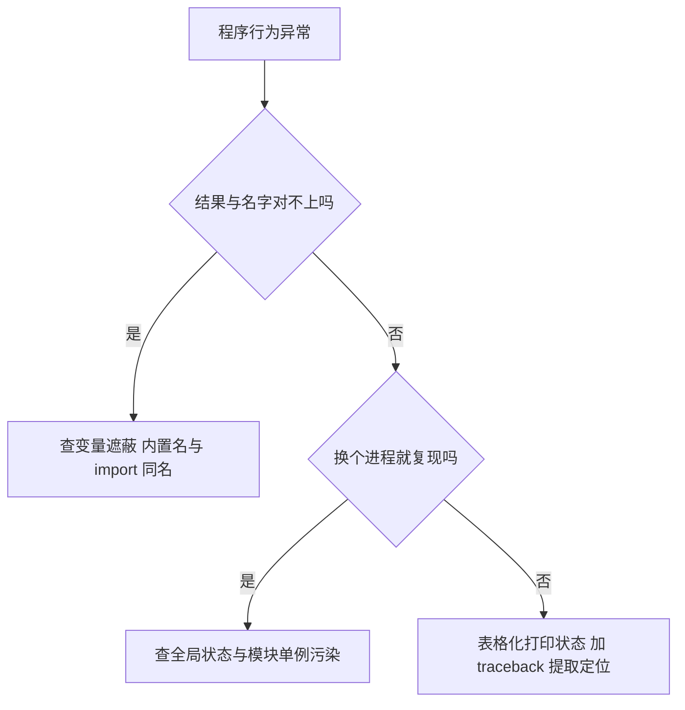

### Q2375 · property 还是方法

> 难度:★★★☆☆ | 标签:property, API 设计, 语义

**问**:什么时候该用 @property,什么时候老老实实写方法?判断标准是什么?

**答**:三条判断标准。成本:property 暗示「读个字段」,应该是廉价的;里面有 IO、大计算、sleep 的逻辑必须写成方法,否则调用方在读属性时被暗算性能。参数与副作用:需要传参、或会引发远端变化(写库、发请求)的是动作,用方法;property 是名词不是动词,`rep.stats(5)` 合理,`rep.stats` 这种隐藏重活就不合理。异常与失败:property 里抛异常很反直觉,读个属性居然炸了,容易漏接;可能失败的操作写成方法,把「这会失败」编码进调用形式。演化路径是 property 的最大价值:先用公开字段 `self.celsius = v`,需要校验时无痕升级为 property + setter,调用方代码一行不改——这是「先简单后复杂」的 API 演化通道。反方向(把昂贵方法改成 property 缓存)要小心首次访问的延迟尖刺。

```python
# file: code/01_语言核心与底层/q2375_property_vs_method.py
"""property 还是方法:按成本、副作用与失败可能性决定。"""
import time


class Report:
    def __init__(self, rows):
        self.rows = rows

    @property
    def count(self):
        """便宜、无副作用,像字段。"""
        return len(self.rows)

    def stats(self, window):
        """带参数、有计算成本,是动作。"""
        return sum(self.rows[-window:]) / min(window, len(self.rows))

    @property
    def slow_summary(self):
        """反例:property 里做重活。"""
        time.sleep(0.05)
        return sum(self.rows)


class Temperature:
    def __init__(self):
        self._c = 20

    @property
    def celsius(self):
        return self._c

    @celsius.setter
    def celsius(self, v):
        if v < -273.15:
            raise ValueError("低于绝对零度")
        self._c = v


if __name__ == "__main__":
    rep = Report(list(range(100)))
    print("count 像字段:", rep.count)
    print("stats 是动作:", rep.stats(5))

    t0 = time.perf_counter()
    _ = rep.slow_summary
    print(f"property 重活耗时: {time.perf_counter() - t0:.3f}s")

    t = Temperature()
    t.celsius = 25
    print("setter 校验后:", t.celsius)
    try:
        t.celsius = -300
    except ValueError as exc:
        print("setter 拒绝:", exc)
```

**追问**:1) cached_property 算哪种?——它是「贵但幂等」的折中:首次访问计算并缓存,之后读字段;但要求对象可变且计算无副作用,frozen 或并发写场景不适用。2) property vs 方法的判定清单?——纯读、快速、无副作用 → property;有参数 → 方法;可能失败(网络/DB) → 方法(异常语义);幂等且贵 → cached_property(Q452)。3) 语义欺骗的风险?——property 做了网络调用,读者以为读字段;setter 带副作用(联动派生)要文档化(Q1811);repr/property 里的重计算拖垮调试器。4) 生产陷阱?——property 内做 IO;cached_property 引用 self 的对象图滞留;方法改名破坏「属性式调用方」。


