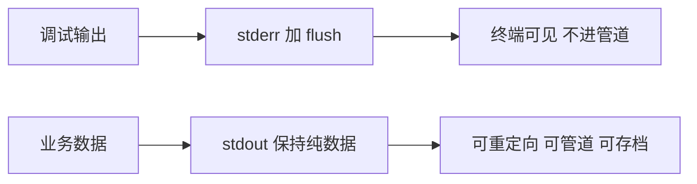

### Q2380 · 调试输出走 stderr 的纪律

> 难度:★★★☆☆ | 标签:stderr, stdout, debug

**问**:为什么调试 print 会污染数据管道?正确的分流怎么做?

**答**:CLI 的铁律:stdout 是数据通道(结果、报表,供重定向与管道消费),stderr 是诊断通道(日志、进度、调试信息)。调试 print 默认走 stdout,一旦输出被重定向到文件或接入下游命令,调试行就混进数据——CSV 里插进一行 [debug],下游解析直接爆炸。纪律三条:调试输出统一 `print(..., file=sys.stderr, flush=True)`,封装成 debug() 函数全库复用;flush=True 保证崩溃前最后的调试信息不滞留缓冲区;正常输出保持纯数据,一条诊断都不要混。验证方法如 demo:把 stdout 重定向到列表,调试行不受影响地去了 stderr,管道两端各自干净。这套分流是 Unix 哲学的一部分,写脚本、写工具、写 CI 步骤时都适用。

```python
# file: code/01_语言核心与底层/q2380_stderr_debug.py
"""调试输出走 stderr:不污染 stdout 的数据管道。"""
import sys


def debug(*args):
    """统一调试出口:stderr 加立即刷新。"""
    print("[debug]", *args, file=sys.stderr, flush=True)


def process(numbers):
    """正常输出只有结果,stdout 保持纯数据。"""
    return [n * 2 for n in numbers]


if __name__ == "__main__":
    data = [1, 2, 3]
    debug("输入:", data)
    result = process(data)
    debug("输出:", result)
    print(*result)                    # 只有结果进 stdout

    captured = []

    class ListWriter:
        def write(self, s):
            captured.append(s)

        def flush(self):
            pass

    real = sys.stdout
    sys.stdout = ListWriter()
    try:
        print("数据行")
        debug("这一行去了 stderr,不混进 stdout")
    finally:
        sys.stdout = real
    print("stdout 只捕到:", captured)
```

**追问**:1) logging 模块和这个纪律什么关系?——logging 默认就写 stderr 且带级别过滤,生产代码用 logging、临时插桩用封装的 debug(),两者都走诊断通道,stdout 始终是纯数据。2) stdout 纪律的完整内容?——stdout 只输出「程序产物」(数据/结果);诊断(进度/调试/告警)走 stderr;退出码表达成败(Q1560);print(..., file=sys.stderr) 或 logging。3) 与管道的配合?——stdout 进 tee/jq 才不被污染;2>&1 合流会破坏纯数据假设;容器采集分别对待(Q555)。4) 生产陷阱?——print 进度条污染 stdout 管道;调试 print 忘删上线;把 stderr 当日志收集(应统一 logging formatter)。


