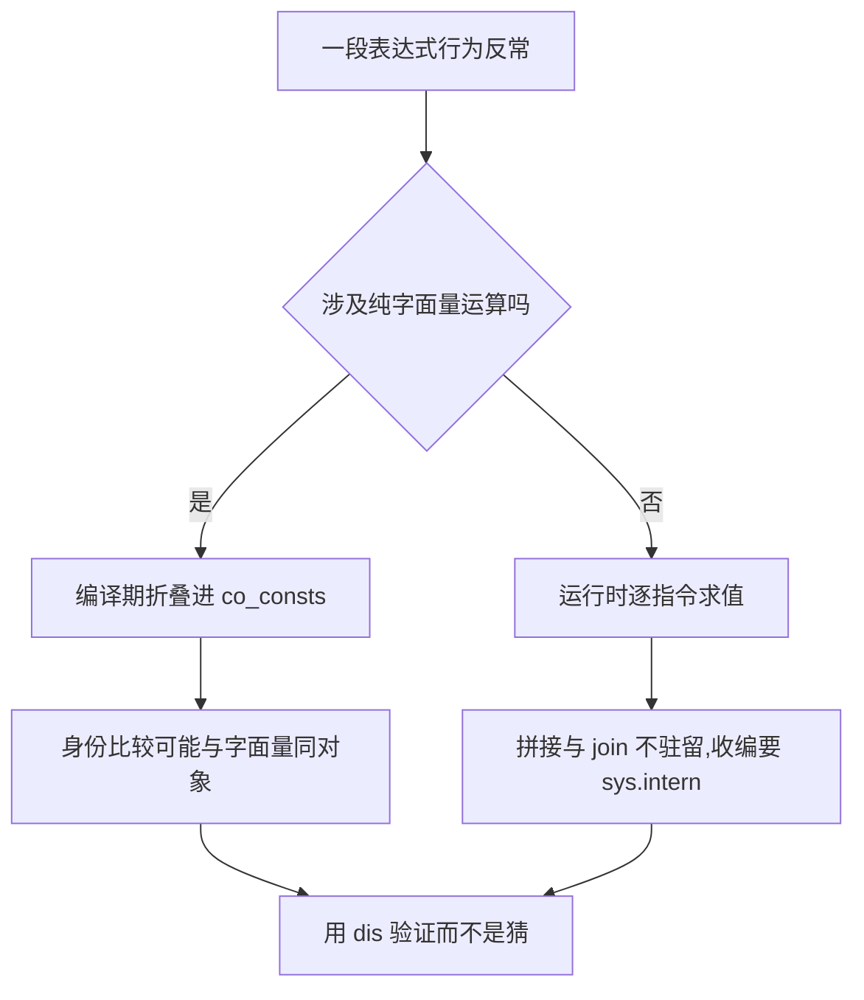

### Q2610 · sys.setrecursionlimit 的代价:C 栈、线程栈与段错误

> 难度:★★★★☆ | 标签:递归, 递归限制, 线程栈

**问**:递归太深报 RecursionError,调高 `sys.setrecursionlimit` 不就行了?它有什么代价?

**答**:`setrecursionlimit` 只是调高解释器里的一个计数门闩,不会给 C 栈多分配一字节——而 CPython 的 Python 层函数调用在 3.9 里对应真实的 C 递归,每一层都要消耗线程栈。所以盲目调高限制,报错会从可控的 `RecursionError` 变成进程级段错误,连 traceback 都没有。正确姿势是两条腿:用 `threading.stack_size` 在创建线程前把栈开大,再在**那个线程里**调高限制,实测本机 256MB 栈 + 限制 300000 可以递归到约 30 万层后干净地抛出 RecursionError。另外注意两点:这个限制是解释器级全局状态,影响所有代码;每层 Python 帧本身在堆上要吃内存,深递归的内存成本也不会因为限制调高而消失。深层递归的根本解法仍然是显式栈迭代或分治改写。

```python
# file: code/01_语言核心与底层/q2610_recursion_limit.py
"""setrecursionlimit 的代价:门闩不等于栈,大栈线程里才能安全调高。"""
import sys
import threading


def count_depth_with_big_stack(limit, stack_bytes):
    """在指定栈大小的线程里递归到极限,返回达到的深度。"""
    result = {}

    def deep():
        sys.setrecursionlimit(limit)
        count = [0]

        def r():
            count[0] += 1
            r()

        try:
            r()
        except RecursionError:
            result["depth"] = count[0]

    threading.stack_size(stack_bytes)
    t = threading.Thread(target=deep)
    t.start()
    t.join()
    threading.stack_size(0)            # 恢复默认,避免影响后续线程
    return result.get("depth")


if __name__ == "__main__":
    # 主线程:默认限制下干净地抛 RecursionError
    sys.setrecursionlimit(1000)

    def boom(n):
        return boom(n + 1)

    try:
        boom(0)
    except RecursionError:
        print("主线程:限制 1000,RecursionError 被正常捕获")

    # 大栈线程:限制 300000 也能干净收场
    depth = count_depth_with_big_stack(300000, 256 * 1024 * 1024)
    print(f"256MB 栈线程:限制 300000,实际递归到 {depth} 层")
```

**追问**:1) 为什么在主线程直接 `setrecursionlimit(10**6)` 很危险?——主线程栈受 ulimit 约束通常只有 8MB,C 递归超栈直接段错误;而 `threading.stack_size` 会在 mmap 线程栈时真正分配空间。2) 限制的真实语义?——getrecursionlimit 是 Python 帧软上限;每次调用同时消耗 C 栈,3.11+ 有 C 栈溢出保护但仍非硬保证(Q553);真正安全线要按「限制 × 每帧 C 栈消耗 < 线程栈大小」估算。3) 工程正解?——深递归改显式栈/迭代(Q1531);要深递归的业务放到大栈子线程(threading.stack_size + 专线程);输入深度限制在校验层。4) 生产陷阱?——调大限制把崩溃推迟成段错误;子线程与主线程深度不同导致环境差异;深层 JSON 解析复现不出(输入深度不同)。


