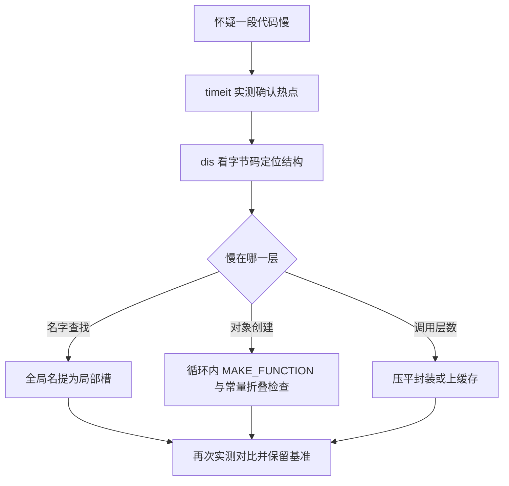

### Q2615 · 函数调用的开销构成:Python 层调用 vs C 层调用

> 难度:★★★★☆ | 标签:调用开销, 性能实测, 帧对象

**问**:调用一个 Python 函数比调用 C 实现的函数慢在哪?差多少?

**答**:每次 Python 层调用都要:创建新帧对象、压参数(3.9 在做参数链表/数组整理)、初始化局部槽、执行完后返回并释放帧——这一整套在 3.9 无法省略。而 C 实现的内建函数(如 `abs`)走的是 `cfunction` 快路径,没有帧分配,只有参数检查。本机实测:Python 函数调用约 160ns/次,内建约 120ns/次,差距 30% 左右;差距在 3.11 后明显缩小(帧对象延迟分配与内联调用)。工程含义有三:热循环里减少无谓的小函数封装层;回调接口尽量传内建或 C 实现的可调用对象;更大量的开销其实在「每次调用都做重复计算」,该上缓存时用 `functools.cache` 比抠调用方式有效得多。

```python
# file: code/01_语言核心与底层/q2615_call_overhead.py
"""调用开销:Python 层函数与 C 内建函数的每次调用成本。"""
import timeit


def py_id(v):
    return v                       # 一个什么都不做的 Python 函数


if __name__ == "__main__":
    n = 500000
    t_py = timeit.timeit(lambda: py_id(7), number=n) / n * 1e9
    t_bi = timeit.timeit(lambda: abs(-7), number=n) / n * 1e9
    print(f"Python 层调用: {t_py:5.0f} ns/次")
    print(f"C 内建调用:   {t_bi:5.0f} ns/次")
    print(f"差距:          +{(t_py - t_bi) / t_bi * 100:.0f}%")
```

**追问**:1) lambda 比普通函数调用更快吗?——不会,lambda 同样是 Python 层调用,机制与开销完全一致,「用 lambda 提速」是常见误解。2) 开销构成?——Python 层调用:建帧/参数打包/字节码执行/返回;C 层调用(list.append、sorted 的 C 路径)省帧;3.11 起内联 Python-to-Python 调用(去帧)让纯 Python 调用显著变快;kwargs 调用比位置参数贵。3) 优化方向?——把热路径回调换成 C 实现(operator.itemgetter,Q2624);减少调用层数;3.11+ 依赖特化;微优化先 profile。4) 生产陷阱?——拿 lambda「优化」;参数打包滥用(**kwargs 热路径);基准没测调用开销占比就重构。


