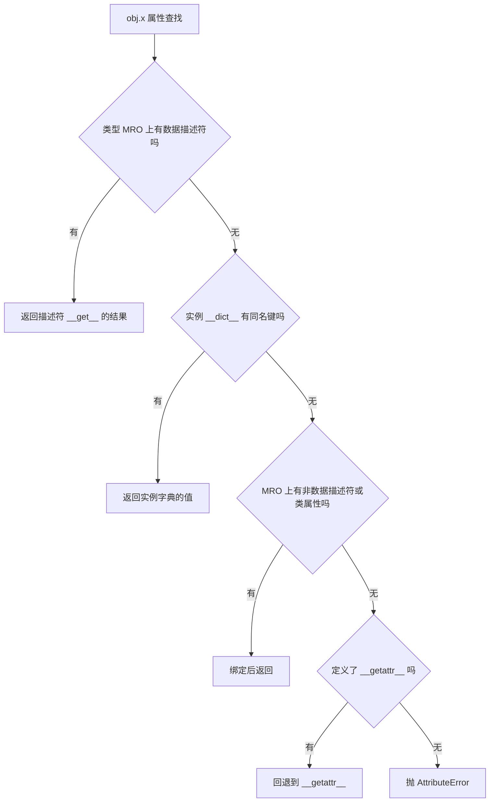

### Q2621 · 描述符的状态放哪里:类级共享陷阱与实例分存

> 难度:★★★☆☆ | 标签:描述符, 状态管理, __set_name__

**问**:自定义描述符需要记录状态(比如访问计数),状态存在 self 上为什么危险?

**答**:描述符实例是**类属性**,全类只有一份:把可变状态存在描述符的 `self.__dict__` 上,所有宿主实例看到的是同一份数据——计数器会串、缓存会互踩,这是描述符最常见的生产 bug。正确做法是 `__set_name__` 拿到属性名后,把状态按「实例 + 属性名」分存到每个宿主实例的 `__dict__` 里;若宿主可能没有 `__dict__`(如 `__slots__` 类),则退回用 `weakref` 建立宿主到状态的映射。判断标准一句话:与单个实例相关的状态进实例字典,真正全类共享的配置(类型校验器对象等)才放描述符自身。

```python
# file: code/01_语言核心与底层/q2621_descriptor_state.py
"""描述符状态存放:存 self 上是全类共享,存实例字典才是每实例一份。"""
import weakref


class SharedStateDesc:
    """反例:计数器存在描述符 self 上,所有实例共用一个数。"""

    def __init__(self):
        self.reads = 0

    def __get__(self, obj, owner=None):
        self.reads += 1
        return self.reads


class PerInstanceStateDesc:
    """正例:状态按实例分存到宿主 __dict__,支持 __slots__ 用 weakref 兜底。"""

    def __init__(self):
        self._states = weakref.WeakKeyDictionary()

    def __set_name__(self, owner, name):
        self.name = name

    def __get__(self, obj, owner=None):
        if obj is None:
            return self
        state = self._states.get(obj)
        if state is None:
            state = {"reads": 0}
            self._states[obj] = state
        state["reads"] += 1
        return state["reads"]


class Page:
    shared = SharedStateDesc()
    per_instance = PerInstanceStateDesc()


if __name__ == "__main__":
    a, b = Page(), Page()
    a.shared; a.shared
    print("a 读两次后 b.shared =", b.shared, "(被 a 污染,共享 bug)")

    a.per_instance
    a.per_instance
    print("a 读两次后 b.per_instance =", b.per_instance, "(各自独立)")
    print("a.per_instance =", a.per_instance)
```

**追问**:1) 为什么用 WeakKeyDictionary 而不是普通 dict?——普通 dict 会以宿主实例为键钉住对象导致无法回收,弱引用字典让状态随宿主一起消亡。2) 状态存放的选型矩阵?——实例 __dict__(常规);slots 槽(省内存);描述符自身属性(全局共享——陷阱);WeakKeyDictionary(描述符类级挂载 + 每实例状态);按「生命周期与共享面」选。3) 与 Q453 的联动?——__set_name__ 给出存储键;类级单例描述符必须避免在 self 上存 per-instance 状态;多字段共享状态用统一弱表。4) 生产陷阱?——描述符实例属性被所有实例共享(本题核心);弱表遍历竞态(Q2068);slots 类无 __dict__ 时弱表也救不回(需要 __weakref__ 槽,Q2074)。


