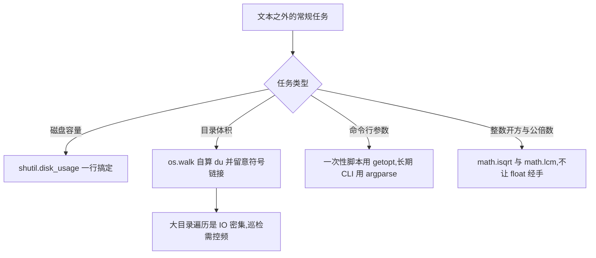

### Q2627 · shutil.disk_usage 与目录体积:du 的最小实现

> 难度:★★☆☆☆ | 标签:shutil, 磁盘, 运维

**问**:怎么用标准库拿磁盘剩余空间、算一个目录占了多少字节?

**答**:`shutil.disk_usage(path)` 返回 `usage(total, used, free)` 三元组,直接读文件系统统计,是「磁盘快满了吗」检查的标准做法。目录体积标准库没有现成的 `du`,惯用实现是 `os.walk` 累加 `os.path.getsize`:注意 `os.walk` 默认不跟进目录符号链接(`followlinks=False`),避免重复计数与环;硬链接会重复计入,严格对齐 `du` 需要用 `os.stat` 的 `st_ino` 去重。大目录遍历是 IO 密集操作,放在巡检脚本里要控制频率,或考虑缓存结果。

```python
# file: code/01_语言核心与底层/q2627_disk_usage.py
"""磁盘用量:disk_usage 与最小 du 实现。"""
import os
import shutil
import tempfile


def du(path):
    """目录总字节数:walk 累加,不跟随目录符号链接。"""
    total = 0
    for root, _dirs, files in os.walk(path):
        for name in files:
            try:
                total += os.path.getsize(os.path.join(root, name))
            except OSError:
                pass
    return total


if __name__ == "__main__":
    usage = shutil.disk_usage("/")
    print(f"磁盘: 总 {usage.total / 2**30:.0f} GiB, "
          f"已用 {usage.used / 2**30:.0f} GiB, "
          f"余 {usage.free / 2**30:.0f} GiB")

    tmp = tempfile.mkdtemp()
    with open(os.path.join(tmp, "a.bin"), "wb") as f:
        f.write(b"\0" * 4096)
    print("临时目录体积:", du(tmp), "字节")
```

**追问**:1) disk_usage 传文件路径会怎样?——合法,它取该文件所在文件系统的统计,语义是「这个路径所在的盘」而不是这个文件的大小。2) du 的最小实现要点?——os.scandir 递归(entry.stat 缓存在 DirEntry,比 stat 快);follow_symlinks=False 防环;硬链接去重(按 inode);分块统计避免长任务无反馈。3) 与监控的关系?——disk_usage 做阈值告警(total/used/free);目录体积审计配合 stat 的 st_size 与 du 算法;注意 sparse 文件(逻辑大小≠占用)。4) 生产陷阱?——递归统计无 symlink 防护死循环;重复硬链接重复计数;大目录阻塞主线程(放线程池)。


