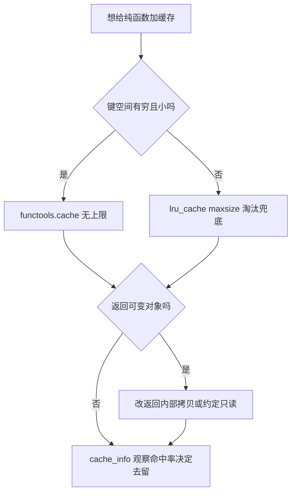

### Q2632 · functools.cache:无界缓存的适用与风险

> 难度:★★★☆☆ | 标签:functools, 缓存, lru_cache

**问**:`functools.cache` 和 `lru_cache` 有什么区别?什么时候不能用它?

**答**:`functools.cache`(3.9+)就是 `lru_cache(maxsize=None)` 的语义化别名:无上限、永不淘汰。适合**键空间有穷且小**的纯函数——枚举值、状态机转移表、固定参数组合;风险是键空间无界时缓存只涨不清,长驻进程里就是内存泄漏,这时该用 `lru_cache(maxsize=N)` 让 LRU 淘汰兜底。与所有按参数哈希的缓存一样有三条通用禁忌:参数必须可哈希;函数必须纯(参数相同结果必须相同);返回可变对象时要意识到缓存把同一对象发给了所有调用方,改它就是改缓存。`cache_info()` 能看到命中率,是判断缓存是否有效的第一手数据。

```python
# file: code/01_语言核心与底层/q2632_functools_cache.py
"""functools.cache:无界缓存的命中、风险与 lru 对照。"""
import functools


@functools.cache
def square(n):
    hits[0] += 1
    return n * n


hits = [0]


@functools.lru_cache(maxsize=2)
def small_lru(n):
    return n * n


if __name__ == "__main__":
    square(4)
    square(4)
    square(5)
    print("实际计算次数:", hits[0], "缓存信息:", square.cache_info())

    small_lru(1); small_lru(2); small_lru(3)   # 挤掉 1
    print("lru(2) 命中:", small_lru.cache_info())
    print("1 已被淘汰,重新计算后:", small_lru(1), small_lru.cache_info())

    # 风险演示:返回可变对象,缓存会被调用方改掉
    @functools.cache
    def default_list():
        return []

    default_list().append("污染")
    print("第二次拿到:", default_list(), "(同一对象被改)")
```

**追问**:1) 怎么给 lru_cache 加过期时间?——它不支持 TTL,需要过期就自己包一层时间戳判断,或用第三方 cachetools;Q444 有手写 TTL 装饰器的完整实现。2) cache 与 lru_cache 的取舍?——cache(maxsize=None):纯 memoization,无淘汰,长进程内存只增(Q478);lru_cache:maxsize 淘汰 + 统计;TTL/过期:自写或 cachetools;缓存键可哈希性是共同前提。3) 并发语义?——两者用线程安全的锁保护字典;并发 miss 会重复计算(锁在检查之后);单飞(single-flight)要另做。4) 生产陷阱?——cache 在长寿命进程泄漏;方法缓存钉住 self(Q478);TTL 语义误解(没有就是永不过期)。


