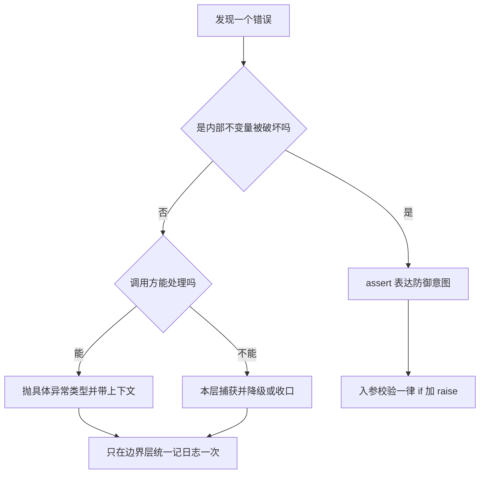

### Q2638 · assert 带括号的陷阱:非空元组恒真

> 难度:★☆☆☆☆ | 标签:assert, 陷阱, 语法

**问**:`assert (x > 0, "x 必须为正")` 为什么永远不触发?正确的断言消息怎么写?

**答**:`assert` 是语法结构不是函数,带括号的写法把 `(cond, "msg")` 整体当成了**断言条件**——一个非空元组永远为真,断言形同虚设,而消息永远不会被看到,CPython 甚至会直接发 SyntaxWarning 提醒「assertion is always true」。正确写法是 `assert cond, "msg"`(逗号在 assert 关键字层面)。这个坑还有个隐蔽推论:有人为了多行写断言加了括号,同样中招。另外复习 `-O` 语义:优化模式下断言连同消息全部被剥掉(`__debug__` 为 False),所以断言只能表达「内部不变量」,对外部输入的校验必须用显式 `if + raise`,这是断言的第一纪律。

```python
# file: code/01_语言核心与底层/q2638_assert_tuple.py
"""assert 元组陷阱与 -O 模式实测。"""
import subprocess
import sys


def check(x):
    assert (x > 0, "x 必须为正")      # 陷阱:非空元组恒真,永不触发
    # 正确写法:assert x > 0, "x 必须为正"(逗号在 assert 语法层,不在括号里)
    return x * 2


if __name__ == "__main__":
    print("check(-5) 竟然通过:", check(-5))

    code = "assert False, 'gone'\nprint('survived')"
    r_off = subprocess.run([sys.executable, "-O", "-c", code],
                           capture_output=True, text=True)
    r_on = subprocess.run([sys.executable, "-c", code],
                          capture_output=True, text=True)
    print("-O 模式退出码:", r_off.returncode, "输出:", r_off.stdout.strip())
    print("默认模式退出码:", r_on.returncode, "消息:", r_on.stderr.strip().splitlines()[-1])
```

**追问**:1) 多行断言想换行怎么办?——用反斜杠或把条件提为临时变量,绝不能用括号包裹;`assert (\n  cond,\n  msg\n)` 就是恒真陷阱。2) 陷阱的机制?——括号把 (cond, msg) 变成非空元组,元组恒真,__bool__ 不看内容(Q532/539);-O 下 assert 又整体消失(Q470)——双重陷阱叠加。3) 防御手段?——ruff/pylint 的 assert-on-tuple 检查;复杂条件提为命名变量;团队 lint 禁多元素断言括号。4) 生产陷阱?——换行书写触发恒真,断言形同虚设;配合 -O 连测试保护都消失;把 assert 当校验层(Q1278)。


