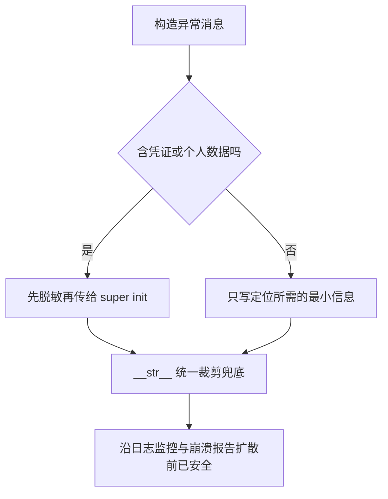

### Q2644 · 异常消息里的敏感数据:str(e) 的信息泄漏面

> 难度:★★★☆☆ | 标签:安全, 异常消息, 数据脱敏

**问**:异常消息里为什么不能随手拼用户输入和凭证?泄漏发生在哪几个环节?

**答**:异常消息的生命周期远比一行 str(e) 长:它可能进日志系统、监控聚合、崩溃报告、API 错误响应,甚至被上游原样透传给浏览器。密码、令牌、连接串(含口令)、身份证号一旦拼进消息,等于沿这条链全量扩散,而且日志系统通常没有字段级脱敏。工程规则:异常消息只含**定位问题所需的最小信息**(哪个操作、哪个资源的非敏感标识);凭证在构造消息前先脱敏或哈希化;自定义异常类在 `__str__` 里做统一裁剪;连接数据库/外部服务的错误要特别小心,驱动抛出的消息可能内嵌 DSN,记录前过一遍 scrub。安全边界之外的额外收益:干净的消息也是可检索的。

```python
# file: code/01_语言核心与底层/q2644_sensitive_message.py
"""异常消息的脱敏:自定义异常在 __str__ 统一裁剪。"""
import re

SECRET_RE = re.compile(r"(token|password|secret)=(\S+)", re.IGNORECASE)


def scrub(text):
    """把键值对形态的凭证替换为占位。"""
    return SECRET_RE.sub(r"\1=***", text)


class ApiError(Exception):
    """对外异常:__str__ 强制脱敏,原始消息不出境。"""

    def __init__(self, message, status):
        super().__init__(scrub(message))
        self.status = status


def call_api(url, token):
    raise ApiError(
        f"POST {url} 失败 token={token} status=401", status=401)


if __name__ == "__main__":
    try:
        call_api("https://api.example.com/v1/user", "s3cr3t-token")
    except ApiError as exc:
        print("对外消息:", exc)
        print("状态码:", exc.status)
```

**追问**:1) 异常的 args 里存了原始未脱敏字符串怎么办?——脱敏必须在 `super().__init__` 之前完成,链路上任何 `repr(e)`/日志都读 args,事后裁剪救不回已出境的副本。2) 泄漏面盘点?——str(e)/repr(e) 进日志、traceback 进监控、HTTP 错误详情回传客户端、异常进消息队列;敏感面:SQL 参数、连接串、令牌、PII。3) 防御设计?——异常构造时脱敏(Q1277 消息设计);错误详情分级(内部详单/外部摘要);全局日志过滤器兜底 + 评审检查 str(e) 直出。4) 生产陷阱?——外层 Exception(str(e)) 把内层敏感消息带出;调试端点直接回传 repr(e);args 带原始值的自定义异常进第三方监控。


