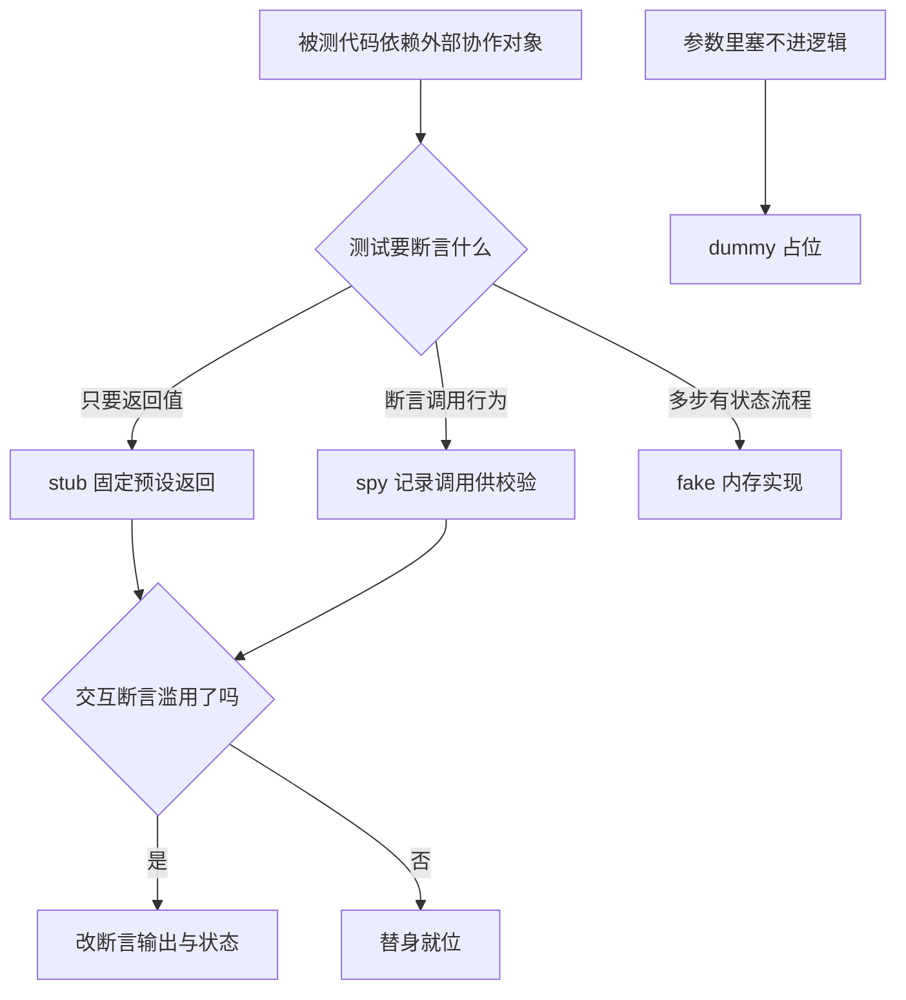

### Q2649 · 测试替身的四类:dummy、stub、spy、fake 的最小实现

> 难度:★★★☆☆ | 标签:测试替身, mock, 测试设计

**问**:测试里总说 mock,但 dummy、stub、spy、fake 有什么区别?各自解决什么问题?

**答**:测试替身按「提供什么」分四类:**dummy** 只是填参数位,从不被真正使用;**stub** 对调用返回固定预设值,解决「依赖返回值」;**spy** 在转发之余记录调用(次数、参数),解决「断言交互行为」;**fake** 是轻量可用实现(内存版仓库),解决「多步有状态流程」。选型看断言对象:断言**状态/输出**优先 stub 与 fake,断言**交互**才用 spy——滥用 spy 会把测试焊死在实现细节上,重构即碎。unittest.mock 的 `MagicMock` 一物多用能扮演全部四类,但手写这几个十行的小类能让学生与新人一眼看懂替身的本质:替身是实现依赖接口的普通对象,没有任何魔法。

```python
# file: code/01_语言核心与底层/q2649_test_doubles.py
"""四类测试替身的手写最小实现与选用场景。"""


class Mailer:
    """被替换的依赖接口。"""

    def send(self, to, subject):
        raise NotImplementedError


class DummyMailer(Mailer):
    """dummy:占位,预期不会被调用。"""

    def send(self, to, subject):
        raise AssertionError("不应发信")


class StubMailer(Mailer):
    """stub:返回固定值,供被测代码走分支。"""

    def send(self, to, subject):
        return True


class SpyMailer(Mailer):
    """spy:转发并记录,断言交互。"""

    def __init__(self):
        self.calls = []

    def send(self, to, subject):
        self.calls.append((to, subject))
        return True


class FakeMailer(Mailer):
    """fake:内存实现,可多步查询。"""

    def __init__(self):
        self.outbox = []

    def send(self, to, subject):
        self.outbox.append((to, subject))
        return True


def notify_user(mailer, user):
    """被测函数:依赖 Mailer 接口。"""
    return mailer.send(user["email"], "welcome")


if __name__ == "__main__":
    user = {"email": "a@b.c"}

    print("stub 返回:", notify_user(StubMailer(), user))

    spy = SpyMailer()
    notify_user(spy, user)
    print("spy 记录:", spy.calls)

    fake = FakeMailer()
    notify_user(fake, user)
    notify_user(fake, user)
    print("fake 收件箱条数:", len(fake.outbox))

    print("dummy 正常情况下不应触发 send")
```

**追问**:1) 什么时候必须用真 fake 而不是 stub?——被测代码对同一依赖有多次有状态交互(写入后再读取)时,stub 的无状态返回无法支撑,内存 fake 才能表达会话语义。2) 四类的最小定义?——dummy:占位参数;stub:固定返回;spy:记录调用供断言;fake:可用的内存实现(dict 当 repo、FakeClock);mock 只是实现这些角色的工具,角色才是设计。3) 取舍?——交互断言(spy)是「实现耦合」应克制;状态断言(通过被测接口查 fake)更稳;mock 库的自动 spec 防接口漂移。4) 生产陷阱?——过度 spy 断言调用次数(重构即碎);fake 与真实实现行为漂移(配契约测试);用 MagicMock 全家桶掩盖接口设计问题。


