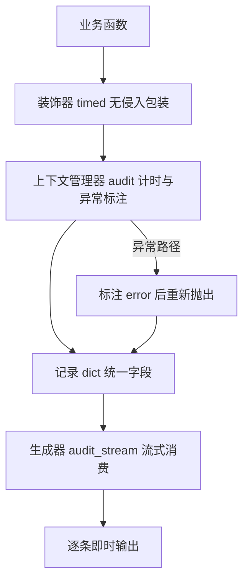

### Q2880 · 类型注解与运行时校验的双层设计

> 难度:★★★☆☆ | 标签:typing, 运行时校验, 边界

**问**:既然有 mypy 这类静态检查,运行时还需要校验吗?如果需要,校验应该加在哪些位置?

**答**:两层各管一段:**静态层**覆盖全部内部调用,注解让 mypy 与 IDE 在开发期拦截类型错误,运行时零开销;**运行层**只守「不可信边界」——HTTP 入参、CLI 参数、外部服务返回值这些静态分析够不到的地方。实测两万次调用,带校验路径明显慢于纯调用,所以原则是「边界校验一次,内部裸奔」:`get_type_hints` 在入口把注解转成可执行检查,内部函数保持只写注解、不写 isinstance 噪音。这样代码不会出现「每个函数开头五行检查」的灾难,也不会因为加了运行时校验而顶掉静态检查的价值。分工口诀:注解是给人与静态工具的契约,边界校验是给运行时数据的地界,不要让任何一层越界干活。

```python
# file: code/01_语言核心与底层/q2880_two_layer_validation.py
"""类型注解与运行时校验的双层设计:静态层管全程,运行层只守边界。"""
import timeit
from typing import get_type_hints


def create_user(name: str, age: int) -> dict:
    """内部函数:只靠注解给静态检查,不做任何运行时检查。"""
    return {"name": name.title(), "age": age, "adult": age >= 18}


def validate_call(func, *args):
    """边界校验器:入口处按注解做一次运行时检查,再放行。"""
    hints = get_type_hints(func)
    param_names = func.__code__.co_varnames[:func.__code__.co_argcount]
    for value, pname in zip(args, param_names):
        expected = hints.get(pname)
        if expected is not None and not isinstance(value, expected):
            raise TypeError(f"参数 {pname} 期望 {expected.__name__},实际 {type(value).__name__}")
    return func(*args)


if __name__ == "__main__":
    print("合法调用:", validate_call(create_user, "alice", 30))

    try:
        validate_call(create_user, "bob", "30")
    except TypeError as e:
        print("边界拦截:", e)

    # 内部调用路径不做校验:正确性交给静态检查,性能留给运行时
    cost_checked = timeit.timeit(lambda: validate_call(create_user, "alice", 30), number=20000)
    cost_plain = timeit.timeit(lambda: create_user("alice", 30), number=20000)
    print(f"2 万次:带校验 {cost_checked:.3f}s vs 纯调用 {cost_plain:.3f}s")
    print("结论:校验只放在边界,内部调用保持零开销")
```

**追问**:1) isinstance 校验拦不住什么?——bool 冒充 int(isinstance(True, int) 为真)、容器内元素的类型(只查外壳不查内容)、鸭子类型对象,严格边界要靠 pydantic 这类带类型收敛的校验器或手写字段级检查。2) 双层设计的职责切分?——静态层(mypy/pyright)管「代码内部的类型正确」;运行时层管「边界不可信输入」(pydantic/Q467);运行时校验成本只在边界付一次。3) 运行时校验的实现层级?——顶层 isinstance 快筛 → 字段级断言(值域/元素类型)→ pydantic 完整 schema;按风险选深度,不做「全量反射校验」的过度工程。4) 生产陷阱?——bool 冒充 int 進数值运算(Q539);嵌套容器只查外壳;校验层与注解两套口径漂移。


