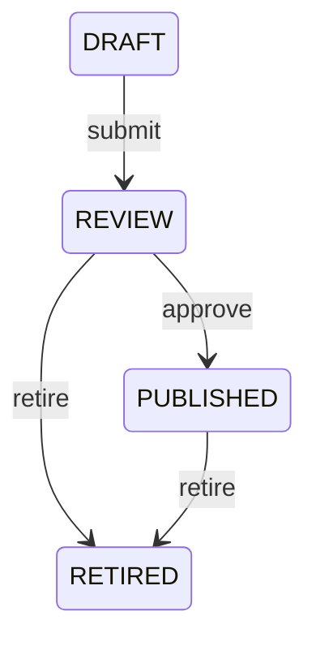

### Q2885 · 字典合并的版本兼容写法:管道、解包与 update

> 难度:★★☆☆☆ | 标签:dict, 版本兼容, PEP 584

**问**:合并两个字典有几种写法?如果库要兼容 3.8 甚至更老的 Python,应该用哪种?

**答**:三种主流写法按版本排:`base | extra` 是 3.9 引入的管道运算符(PEP 584),语义最直白;`{**base, **extra}` 从 3.5 起可用,解包重建新字典,是跨老版本的首选;`dict(base).update(extra)` 任何版本都能跑,复制后原地改。三者都是**右优先**:键冲突时 extra 的值胜出,且都不动入参。兼容性之外的必讲陷阱是**浅合并**:任何一种写法遇到嵌套 dict 都是整个子字典被右值替换,而不是递归合并,配置合并场景这是高频事故源。工程建议:库代码用 `{**a, **b}` 写到最低支持版本淘汰为止,应用代码在 3.9+ 直接用管道运算符,嵌套配置老老实实写递归合并函数,别指望运算符替你深合并。

```python
# file: code/01_语言核心与底层/q2885_dict_merge.py
"""字典合并的版本兼容写法:管道运算符、解包与 update 的取舍。"""
import sys


def merge_pipe(base, extra):
    """3.9+ 可用:新增的 | 运算符,右优先,返回新字典。"""
    return base | extra


def merge_unpack(base, extra):
    """3.5+ 可用:解包重建新字典,跨老版本的首选写法。"""
    return {**base, **extra}


def merge_update(base, extra):
    """update 法:复制后原地改,语义与上面两种等价。"""
    out = dict(base)
    out.update(extra)
    return out


if __name__ == "__main__":
    base = {"a": 1, "b": 2}
    extra = {"b": 20, "c": 30}

    print("管道法:", merge_pipe(base, extra))
    print("解包法:", merge_unpack(base, extra))
    print("update 法:", merge_update(base, extra))

    print("base 未被修改:", base)
    print("右优先覆盖:", merge_unpack(base, extra)["b"])
    print("本机版本:", f"{sys.version_info.major}.{sys.version_info.minor}")

    # 常见坑:合并是浅的,嵌套结构被整体替换而不是递归合并
    nested_a = {"db": {"host": "a", "port": 1}}
    nested_b = {"db": {"port": 2}}
    print("浅合并覆盖整个子字典:", {**nested_a, **nested_b})
```

**追问**:1) 标准库有现成的深合并吗?——没有,核心团队多次拒绝加入;自己写十几行递归(两边都是 dict 才下钻,否则右覆盖),或用第三方 deepmerge 类小库。2) 三种合并的语义边界?——| 与 {**} 浅合并(右覆盖),update 原地(Q480);深合并递归下钻;列表是覆盖还是拼接要显式决策——语义歧义正是「标准库不收」的原因。3) 深合并的实现纪律?——只对「两边都是 dict」下钻;冲突策略可配置;环引用防死递归;配置合并建议显式分层(ChainMap,Q1534)而不是深合并。4) 生产陷阱?——深合并把列表当 dict 递归崩;环引用死递归;「覆盖 vs 合并」语义与调用方预期不一致;为深合并引入重依赖。


