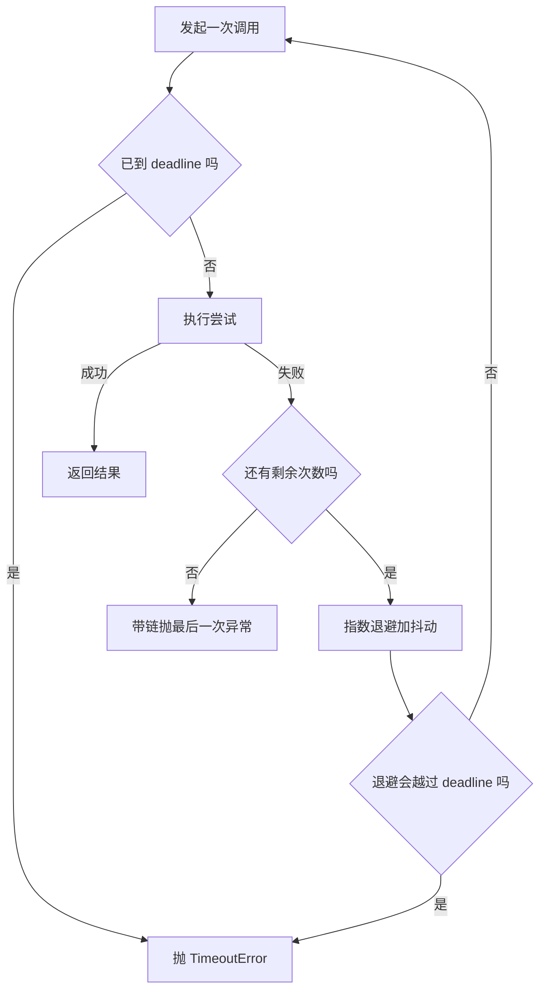

### Q2890 · 重试与超时的统一原语:deadline 感知的 run_with_retry

> 难度:★★★★☆ | 标签:重试, 超时, 指数退避

**问**:重试装饰器和超时控制经常各写各的,怎么把它们设计成一个统一原语?谁是第一公民?

**答**:统一的关键是让**整体 deadline 优先于重试次数**:`run_with_retry` 用 time.monotonic 记起点,每次尝试前查 deadline,失败后的退避延迟如果会越过 deadline 就直接放弃——宁可少试也不超时,比「试满 N 次再看」的写法体验好得多。退避用 `base_delay * 2 ** (i-1)` 指数增长加随机抖动,避免下游恢复瞬间被重试风暴再次打垮。三个设计点:第一,可重试异常用 retry_on 参数声明,默认只认自定义的 AttemptFailed,不盲目吞所有异常;第二,deadline 与 attempts 是「先到为准」的关系,次数耗尽抛最后一次异常并带 from exc 异常链,deadline 到点抛 TimeoutError;第三,用 monotonic 而不是 time.time,防止系统改墙钟把等待时间算错。本机实测三次抖动的下游在第 3 次成功,无恢复的下游被 deadline 在 0.09 秒截停。

```python
# file: code/01_语言核心与底层/q2890_retry_timeout.py
"""重试与超时的统一原语:deadline 感知的 run_with_retry。"""
import random
import time


class AttemptFailed(Exception):
    pass


def run_with_retry(func, args=(), kwargs=None, *, attempts=5,
                   base_delay=0.01, deadline_s=1.0, retry_on=(AttemptFailed,)):
    """统一原语:整体 deadline 优先于重试次数,指数退避加抖动。"""
    kwargs = kwargs or {}
    started = time.monotonic()
    last_exc = None
    for i in range(1, attempts + 1):
        if time.monotonic() - started >= deadline_s:
            raise TimeoutError(f"deadline 已到,共尝试 {i - 1} 次")
        try:
            return func(*args, **kwargs)
        except retry_on as exc:
            last_exc = exc
            if i == attempts:
                break
            delay = base_delay * 2 ** (i - 1) + random.uniform(0, base_delay)
            if time.monotonic() - started + delay > deadline_s:
                raise TimeoutError(f"退避将越过 deadline,放弃于第 {i} 次后") from exc
            time.sleep(delay)
    raise AttemptFailed(f"{attempts} 次尝试全部失败,最后一次:{last_exc!r}")


class Flaky:
    """模拟前几次必失败的下游调用。"""

    def __init__(self, fail_times=2):
        self.fail_times = fail_times
        self.calls = 0

    def __call__(self):
        self.calls += 1
        if self.calls <= self.fail_times:
            raise AttemptFailed(f"第 {self.calls} 次抖动")
        return "ok"


if __name__ == "__main__":
    random.seed(7)
    flaky = Flaky(fail_times=2)
    print("重试成功:", run_with_retry(flaky), "实际调用", flaky.calls, "次")

    always = Flaky(fail_times=99)
    try:
        run_with_retry(always, attempts=3, base_delay=0.005)
    except AttemptFailed as e:
        print("次数耗尽:", e)

    started = time.monotonic()
    try:
        run_with_retry(Flaky(fail_times=99), attempts=50, base_delay=0.05, deadline_s=0.12)
    except TimeoutError as e:
        print("deadline 截停:", e, f"耗时 {time.monotonic() - started:.2f}s")
```

**追问**:1) 整体 deadline 与单次调用超时的区别是什么?——deadline 是调用链共享的时间预算,层层传递逐段消耗;单次超时只约束一次调用,叠加重试可能远超用户耐心,所以统一原语必须以 deadline 为第一公民。2) run_with_retry 的设计要点?——每次重试前检查剩余预算;退避加抖动(Q443);只重试瞬时错误;预算耗尽抛聚合异常(带尝试次数);与单次超时取 min。3) 与 asyncio 的对接?——wait_for 单次、loop.time() 算剩余;gRPC deadline propagation 同构(Q1285)。4) 生产陷阱?——重试不查预算拖垮下游;单次超时×次数无界;退避无抖动的同步风暴;非幂等操作重试(Q443)。


