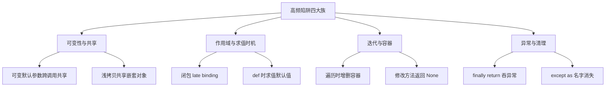

### Q2895 · 常见面试题的陷阱总结(上):可变性、作用域与迭代

> 难度:★★★☆☆ | 标签:面试陷阱, 作用域, 可变性

**问**:语言核心类的高频陷阱题可以归纳成哪几族?每一族的「为什么」是什么?

**答**:收官前把本类散落的高频坑收拢成五连测,跑一遍胜过背十遍:**陷阱一** list.sort 这类修改方法是原地操作返回 None,同族还有 append、update、add,「返回值思维」踩空;**陷阱二** 闭包 late binding,lambda 捕获的是变量不是值,循环结束 i 停在 2,i=i 默认参固化是标准解;**陷阱三** 遍历字典时增删键,下一次 next 触发 RuntimeError,同族还有遍历列表跳元素,正解是遍历副本或先收集后修改;**陷阱四** 默认参数在 def 时求值一次,可变默认值跨调用共享同一列表,两次调用滚成 [1, 1];**陷阱五** is 与 == 的边界,常量折叠让字面量拼接共享对象,运行时构造绝不保证,身份比较只该用于 None 等哨兵。每族陷阱的答题框架相同:先说语义(谁在什么时机求值),再落到可验证实验,最后给防御写法。

```python
# file: code/01_语言核心与底层/q2895_traps_part1.py
"""常见面试陷阱总结(上):可变性、作用域与迭代的高频坑。"""


def trap_return_of_mutator():
    """陷阱一:list.sort 这类修改方法是原地操作,返回 None。"""
    lst = [3, 1, 2]
    result = lst.sort()
    return result, lst


def trap_late_binding():
    """陷阱二:闭包捕获变量本身,循环结束 i 停在 2。"""
    funcs = [lambda: i for i in range(3)]
    fixed = [lambda i=i: i for i in range(3)]
    return [f() for f in funcs], [f() for f in fixed]


def trap_mutate_while_iterate():
    """陷阱三:遍历字典时增删键,下一次 next 立刻炸。"""
    d = {"a": 1, "b": 2, "c": 3}
    try:
        for k in d:
            if k == "a":
                del d[k]
    except RuntimeError as e:
        return str(e)[:20] + "..."
    return "未触发,行为随版本有差异"


def trap_mutable_default(acc=[]):
    """陷阱四:默认值在 def 时求值一次,跨调用共享同一列表。"""
    acc.append(1)
    return acc


def trap_is_vs_eq():
    """陷阱五:常量折叠的对象可能相同,运行时构造绝不该赌 is。"""
    a = "hello world!"
    b = "hello" + " " + "world" + "!"            # 编译期折叠
    c = "".join(["hello", " ", "world", "!"])    # 运行时构造
    return a is b, a is c, a == c


if __name__ == "__main__":
    print("陷阱一 sort 返回值与原列表:", trap_return_of_mutator())
    print("陷阱二 late binding 与固化:", trap_late_binding())
    print("陷阱三 遍历时删键:", trap_mutate_while_iterate())
    print("陷阱四 默认参数跨调用共享:", trap_mutable_default(), trap_mutable_default())
    print("陷阱五 is 与 == 的三个结果:", trap_is_vs_eq())
```

**追问**:1) 陷阱题怎么准备最有效?——把每个坑亲手跑一遍而不是背结论,理解「为什么」之后,陷阱换件马甲(append 换 add、dict 换 list)依然能答对。2) 上篇陷阱的完整链?——可变默认参数→+= 语义→遍历中修改(Q2366)→可变 key 漂移(Q1297)→闭包晚绑定(Q527)→[[0]*3]*3(Q529)→字符串拼接假设(Q1293);每条都有「机制解释」而不仅是「现象」。3) 答题策略?——先给结论、再给机制、最后给防御写法;主动提「这是实现细节/这是协议保证」的分类;引用实测(id、dis)作为证据。4) 生产陷阱?——背结论不懂机制,换壳即错;把 CPython 细节当语言保证;只答「现象」不答「防线」。


