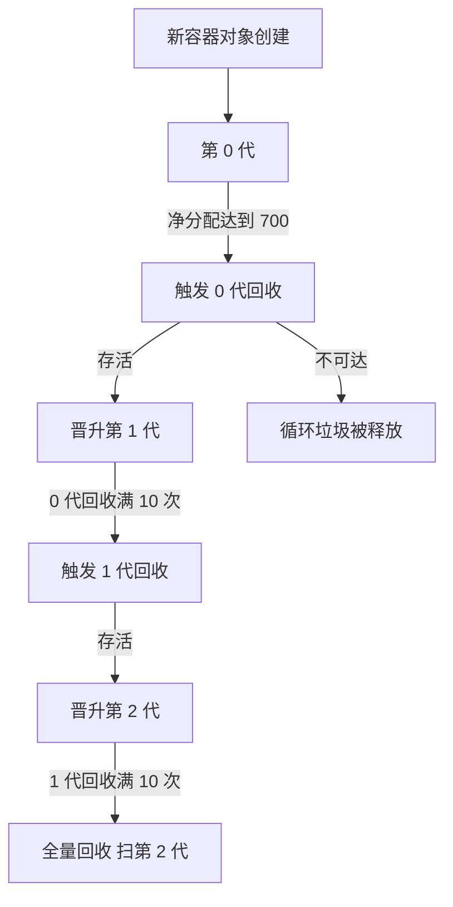

### Q402 · gc 分代机制与 thresholds 调优

> 难度:★★★★★ | 标签:GC, 分代回收, 调优

**问**:`gc.get_threshold()` 返回的三个数字是什么含义?为什么新生代用 700 这样的阈值而不是按时间触发?生产上把 threshold0 调大会有什么风险?

**答**:CPython 把容器对象分成 0/1/2 三代:新容器对象进第 0 代,熬过一次 collection 晋升到下一代,代越高回收越少触发。`(700, 10, 10)` 的含义是:第 0 代每新增 700 个容器对象(减去释放数,即分配减回收的净差)触发一次 0 代回收;0 代每回收 10 次触发一次 1 代;1 代每回收 10 次触发一次 2 代。依据是弱代假说:大多数对象朝生暮死,频繁扫年轻代、少扫老年代摊薄成本。调大 threshold0 可以降低 GC 频率、提升吞吐,但环状垃圾滞留时间变长、峰值内存升高;全量扫第 2 代是 stop-the-world 的,老年代堆积大对象时单次暂停会明显劣化。

```python
# file: code/01_语言核心与底层/q402_gc_generations.py
import gc

print("thresholds:", gc.get_threshold())        # (700, 10, 10) 默认值
print("counts before:", gc.get_count())         # 三个代各自的计数器

class Box:
    pass

boxes = [Box() for _ in range(700)]
gc.collect()                                    # 手动触发,观察计数变化

# 晋升演示:多次回收后,存活对象从 0 代晋升到更高代
for _ in range(5):
    gc.collect()
print("counts after:", gc.get_count())
print("gen2 objects tracked:", len(gc.get_objects(2)))
```

**追问**:1) `gc.freeze()` 是干什么用的?——把当前所有对象移出各代、挪到永久代,pre-fork 服务在 fork 前调用可以让子进程不背 GC 扫描成本(Instagram 的经典实践)。2) 为什么 tuning 时要盯 `gc.get_stats()`?——可以看到每代实际回收次数和 collection 时间,判断是分配风暴还是老年代膨胀。


