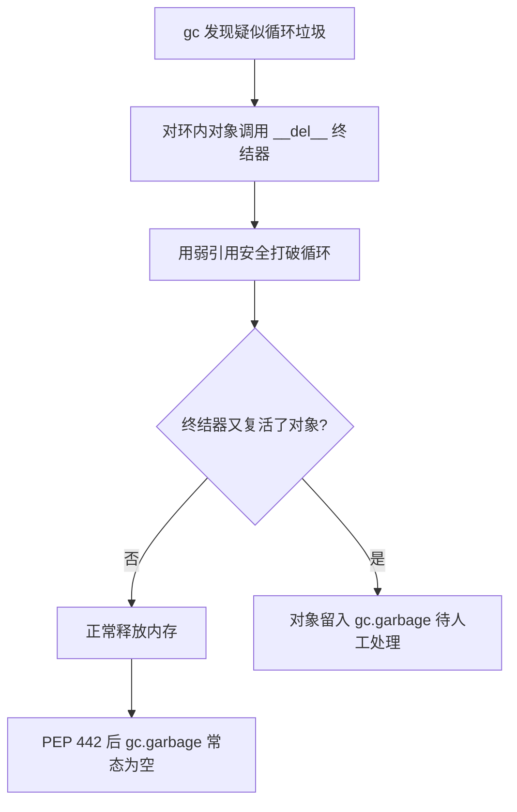

### Q403 · __del__ 与 PEP 442:终结器为什么不再"未定义"?

> 难度:★★★★★ | 标签:GC, PEP 442, __del__

**问**:老版本 Python 里带 `__del__` 的循环引用对象被称为 "uncollectable",进了 `gc.garbage` 就永远泄漏。PEP 442 改了什么?现在 `gc.garbage` 还会出现东西吗?

**答**:Python 3.4 起(PEP 442)safe object finalization 落地:GC 发现循环垃圾后,先对环内带 `__del__` 的对象调用终结器,再用弱引用安全地打破环,最后照常释放内存。所以现代 CPython 中带 `__del__` 的循环引用也能被回收,`gc.garbage` 常态为空——只有解释器关闭阶段或使用旧式 `tp_del` 的 C 扩展类型等极端情况才可能非空;注意 `gc.disable()` 只是让循环垃圾滞留堆里(泄漏但不进 garbage 列表,因为没有回收动作发生)。但 `__del__` 仍不被推荐:调用时机不确定(只在 GC/引用计数归零时),异常会被吞掉只打 stderr,且解释器退出时模块全局可能已被清空。生产代码里应优先用上下文管理器或 `weakref.finalize`。

```python
# file: code/01_语言核心与底层/q403_del_pep442.py
import gc

class Node:
    def __del__(self):
        print("finalizing", hex(id(self) & 0xFFFF))

a, b = Node(), Node()
a.peer, b.peer = b, a          # 循环引用 + 双方都有 __del__
del a, b

print("garbage list:", gc.garbage)
n = gc.collect()               # PEP 442 之前这里回收不了,现在可以
print("collected:", n, "| garbage now:", gc.garbage)
```



**追问**:1) `weakref.finalize` 相比 `__del__` 好在哪?——它注册的是独立回调对象,持有弱引用不阻止回收,回调通过全局注册表访问资源,不怕模块全局被提前清空。2) `atexit` 和 `__del__` 的执行顺序问题?——`atexit` 先于解释器 teardown 执行,而退出阶段的 `__del__` 可能遇到半拆除的模块状态,这是退出时资源泄漏的常见来源。
