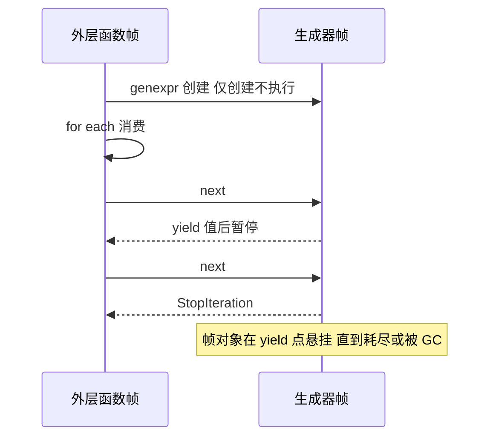

### Q408 · 推导式在 3.12 的优化:PEP 709 内联推导式

> 难度:★★★★☆ | 标签:dis, PEP 709, 性能

**问**:老版本 Python 里列表推导式会创建一个隐藏函数,这带来什么开销?PEP 709 改了什么?如何用 `dis` 证明一个推导式是内联的还是函数式的?

**答**:CPython 3.11 及之前,每个推导式编译成一个名为 `<listcomp>` 的隐藏函数,每次推导要真实压栈一个帧、创建函数并调用——闭包变量要转成 cell,异常回溯里还会出现 `<listcomp>` 帧。PEP 709(Python 3.12)把推导式**内联**到外层函数的字节码里,用 `SWAP`/`COPY` 加临时作用域指令模拟隔离,消除了帧创建成本(官方口径小推导式快 20-50%),回溯里也不再出现独立帧。判断方法:`dis.dis` 看到独立 `<listcomp>` code object 就是老式,看到 `SWAP 2`/`POP_TOP` 与主体混在一起就是 3.12+ 内联式。注意内联后推导式内部不再能通过独立帧隔离名字,行为上更接近普通代码块。

```python
# file: code/01_语言核心与底层/q408_pep709_inline.py
import dis, sys

def build():
    xs = [i * 2 for i in range(5)]
    return xs

print(sys.version_info[:2])
print(build())

code = build.__code__
comps = [c for c in code.co_consts if hasattr(c, "co_name")]
print("hidden comp functions:", [c.co_name for c in comps])
# 3.11 及以前: ['<listcomp>']  3.12+: []  —— PEP 709 已内联

print("---- outer bytecode ----")
dis.dis(build)
# 3.12+ 直接可见 RANGE/LOAD_FAST/SWAP 等指令,无 CALL <listcomp>
```

**追问**:1) 字典/集合推导式和生成器表达式也内联吗?——列表、字典、集合推导式都被 PEP 709 内联,但生成器表达式仍然创建独立函数对象(它本身就是一个迭代器对象,必须有自己的帧)。2) 生成器表达式为什么必须独立帧?——`genexpr` 的生命周期可能超出外层函数,需要独立栈帧悬挂执行。


