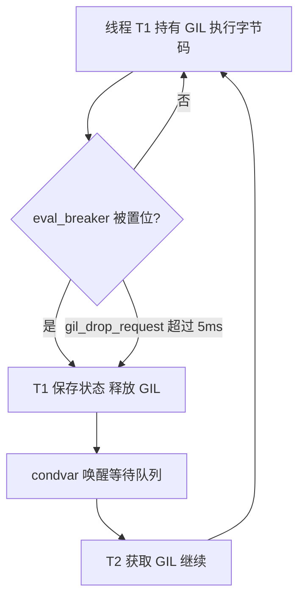

### Q410 · GIL 切换机制与 sys.setswitchinterval

> 难度:★★★★★ | 标签:GIL, 线程, 并发

**问**:GIL 到底是怎么切换线程的?为什么 `while True: pass` 一个线程能"饿死"另一个?`sys.setswitchinterval(0.000001)` 把间隔调小,多线程一定更快吗?

**答**:GIL 是保护解释器状态(尤其是引用计数)的互斥锁。当前持锁线程执行到一定条件后主动释放:`eval_breaker` 机制在每个字节码边界检查"是否有线程请求 GIL",请求线程设置标志后,持锁线程在检查点放弃 GIL 并用 condvar 唤醒等待者。旧行为按指令数(默认 100 条)切换,Python 3.2 起改为按时间:`sys.getswitchinterval()` 默认 5ms,等待线程超过间隔后发出 `gil_drop_request`。因此 CPU 密集线程会在字节码边界让出,但若某线程长时间卡在不经过字节码边界的 C 扩展里(如大 numpy 运算、`time.sleep` 除外——它显式释放 GIL),别人就要等它返回。把 switchinterval 调小会增加锁竞争与上下文切换开销,总吞吐往往不升反降——切换是成本,不是并行度。

```python
# file: code/01_语言核心与底层/q410_gil_switch.py
import sys
import threading
import time

print("switch interval:", sys.getswitchinterval())   # 默认 0.005 秒

counter = 0
N = 200_000

def busy():
    global counter
    for _ in range(N):
        counter += 1          # 字节码级非原子:LOAD/ADD/STORE 三步

t0 = time.perf_counter()
threads = [threading.Thread(target=busy) for _ in range(4)]
[t.start() for t in threads]
[t.join() for t in threads]
print("expect", 4 * N, "got", counter, "elapsed", round(time.perf_counter() - t0, 3))
# 计数大概率不等于期望值:GIL 只保证字节码间切换,不保证复合操作原子

# 收紧切换间隔:切换更频繁,上下文切换开销上升
sys.setswitchinterval(0.0001)
counter = 0
t0 = time.perf_counter()
threads = [threading.Thread(target=busy) for _ in range(4)]
[t.start() for t in threads]
[t.join() for t in threads]
print("small interval elapsed", round(time.perf_counter() - t0, 3), "got", counter)
```

**追问**:1) 为什么 `counter += 1` 在有 GIL 时仍不安全?——它编译成多条字节码,线程可能在 LOAD 与 STORE 之间被切换,丢失更新;GIL 保证的是"单条字节码相对原子"。2) 哪些 C 层调用会主动放 GIL?——`time.sleep`、文件/网络 IO、`hashlib` 大块计算、numpy 多数运算等,放锁期间其他线程可跑字节码。


