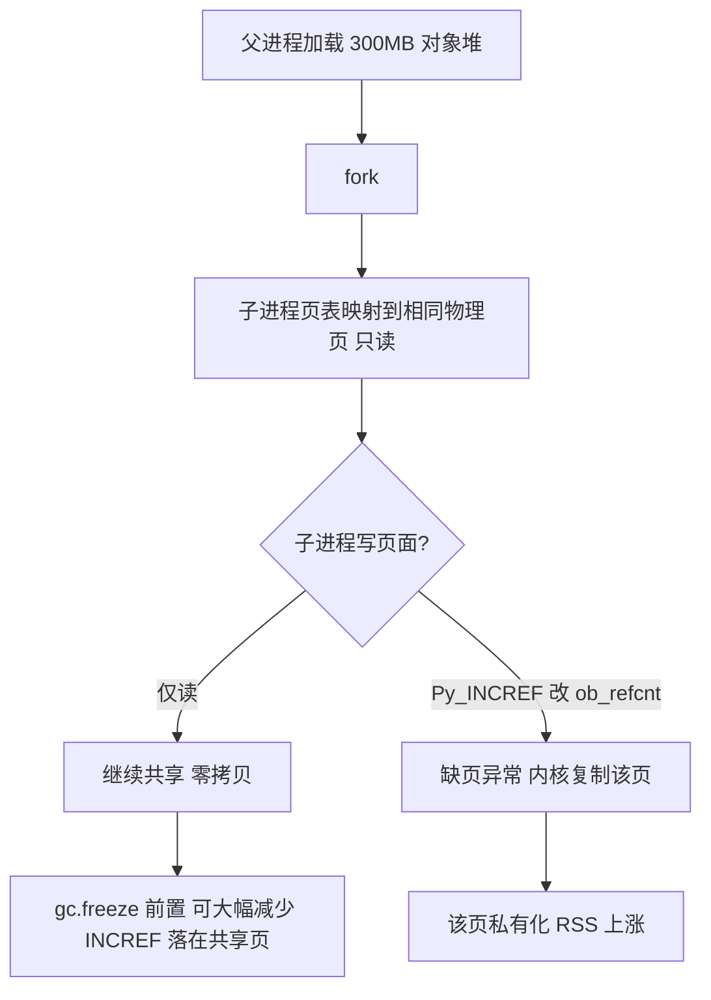

### Q413 · Copy-on-Write 与 pre-fork 服务的 RSS 上涨

> 难度:★★★★★ | 标签:fork, COW, 内存

**问**:一个 pre-fork 的 Web worker 常驻 300MB,父进程加载完模型后 fork 出 16 个子进程,为什么总 RSS 看起来是 5GB?共享内存怎么确认?什么操作会"偷偷打破"COW 共享?

**答**:fork 后父子共享物理页,内核把页表标成只读,写时才触发缺页并复制——所以子进程创建瞬间的真实增量很小。但 CPython 的引用计数恰好是"读也会写":任何对象只要被 `Py_INCREF` 就要改对象头的 `ob_refcnt`,触发 COW 缺页复制。Python 程序的每次函数调用都在动全局对象(类型对象、intern 字符串、模块字典、GC 头里的 gc_refs),随时间推移共享页逐页"私有化",RSS 一路爬升。缓解手段:`gc.freeze()` 在 fork 前把存活对象移出 GC 追踪(避免 GC 头被改写)、fork 前预热并尽量少碰、用 `sys.intern` 收敛字符串、改用 spawn + 共享内存(`multiprocessing.shared_memory`)或 arrow/零拷贝结构。确认共享量:Linux 下看 `/proc/PID/smaps` 逐 VMA 的 `Shared_Clean`/`Private_Dirty`,或 `/proc/PID/smaps_rollup` 的聚合视图(Linux 4.14+),也可用 `smem` 的 USS 列。注意内核并无 rollout 这类文件,正确名称是 rollup。

```python
# file: code/01_语言核心与底层/q413_cow_rss.py
import gc
import os
import resource
import sys

def rss_mb():
    return resource.getrusage(resource.RUSAGE_SELF).ru_maxrss / 1024   # macOS 单位 KB

big = [i for i in range(300_000)]     # 模拟父进程持有的共享数据
gc.collect()
gc.freeze()                            # 关键:fork 前冻结,减少 GC 触碰共享对象头
print("parent rss~", round(rss_mb(), 1), "MB")

pid = os.fork()
if pid == 0:
    # 子进程:如果在这里大量 touch 列表元素/增减引用,共享页被逐页私有化
    s = 0
    for x in big[:100_000]:
        s += x                          # 读 + 隐式 INCREF,逐步打破 COW
    print("child touched pages, sum", s)
    os._exit(0)
else:
    os.waitpid(pid, 0)
    print("parent rss after fork:", round(rss_mb(), 1), "MB")
    print("smaps (linux only):", os.path.exists("/proc/self/smaps"))
```

**追问**:1) 为什么 Instagram 要给 CPython 打 `gc.freeze` 补丁后来进官方?——他们的 uwsgi pre-fork 集群 GC 扫描会改写每个对象的 GC 头,导致 fork 后共享页大面积私有化,冻结后省下约 GB 级内存。2) `ob_refcnt` 改写躲得开吗?——3.12 的 immortal objects 把高频对象(如 `None`、小整数、interned 字符串)计数置为永不递减的饱和值,显著减少 COW 触发,这正是该 PEP 的动机之一。


