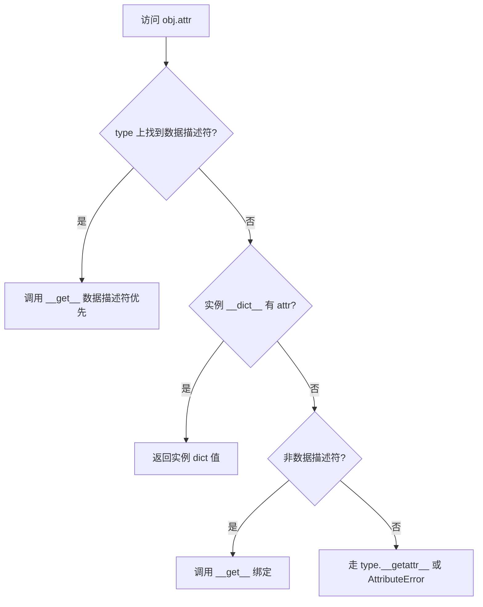

### Q421 · 描述符协议:ORM 字段与 property 的同源原理

> 难度:★★★★★ | 标签:描述符, ORM, 元编程

**问**:为什么 `MyModel.field` 能拦截读写?`property`、`classmethod`、`staticmethod`、ORM 的 `CharField` 共同点是什么?数据描述符和非数据描述符在属性查找顺序里的位置差在哪?

**答**:描述符是定义了 `__get__`/`__set__`/`__delete__` 之一的类,存取发生在**类型上的属性查找**(type.__getattribute)而非实例字典。`property`、函数(经 `__get__` 绑定成 method)、`classmethod`、ORM 字段全是描述符。关键分界:定义了 `__set__`(或 `__delete__`)的是**数据描述符**,查找优先级高于 `instance.__dict__`(所以 `property` 无 setter 时赋值报 AttributeError,而不是写进实例 dict);只有 `__get__` 的是非数据描述符,实例 dict 可遮蔽它。ORM 字段正是数据描述符:`__set__` 做类型校验并标记 dirty,`__get__` 触发延迟加载;`__set_name__`(PEP 487)在类创建时自动把字段名传给描述符,免去 ORM 手动登记。

```python
# file: code/01_语言核心与底层/q421_descriptor_orm.py
import weakref

class Field:
    def __set_name__(self, owner, name):    # 类体创建时自动调用
        self.name, self.attname = name, "_" + name
    def __get__(self, obj, objtype=None):
        if obj is None:
            return self                     # 类访问返回字段对象本身,ORM 靠这拿元数据
        return getattr(obj, self.attname)
    def __set__(self, obj, value):
        if not isinstance(value, str):
            raise TypeError(f"{self.name} must be str")
        obj.__dict__[self.attname] = value
        obj.__dirty__.add(self.name)        # 数据描述符优先于实例 dict

class Model:
    name = Field()
    def __init__(self):
        self.__dirty__ = set()

class User(Model):
    pass

u = User()
u.name = "alice"                 # 走 Field.__set__
print("dirty:", u.__dirty__)
print("via descriptor:", u.name) # 走 Field.__get__
try:
    u.name = 42
except TypeError as e:
    print("validation:", e)

print("类访问返回字段:", User.name.__class__.__name__)
print("查找优先级演示: 数据描述符压过实例 dict")
```



**追问**:1) 为什么函数默认是非数据描述符设计?——允许实例属性遮蔽方法(猴子补丁单实例),这是有意的灵活性。2) `functools.cached_property` 属于哪类、并发下有什么问题?——非数据描述符,首次访问后写实例 dict 实现缓存;并发行为分版本:3.8-3.11 自带类级写锁(保证不重复计算但争用高),3.12 起 gh-90459 移除了锁,并发首次访问可能重复计算(最后写入者胜,结果通常一致),要精确去重需自行加锁(详见 Q452)。
