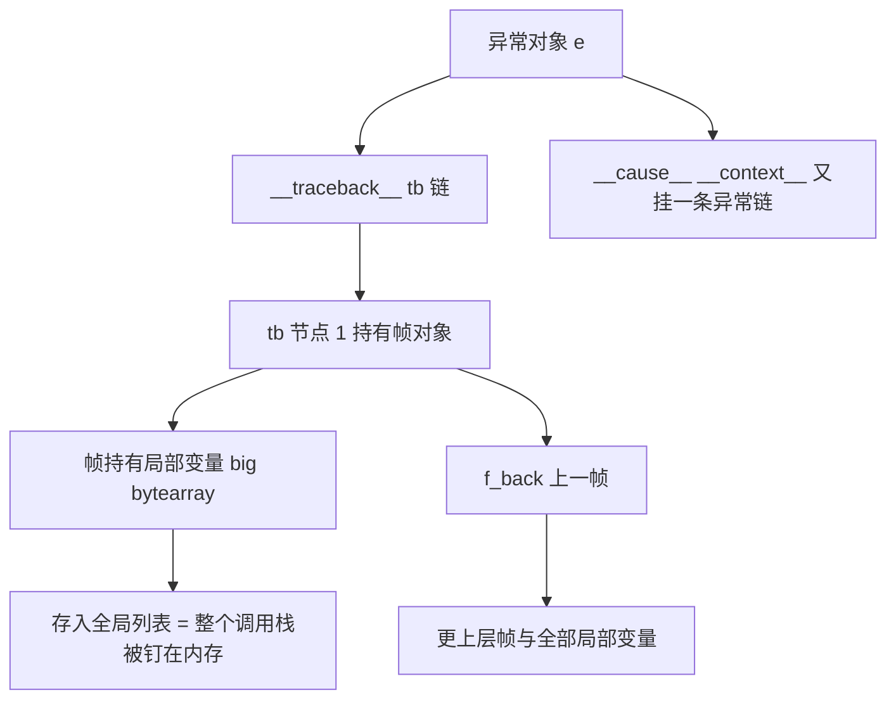

### Q424 · 逃逸的异常 traceback:内存滞留的隐形元凶

> 难度:★★★★☆ | 标签:异常, traceback, 内存泄漏

**问**:为什么 `except Exception as e:` 块结束后把 `e` 存进日志列表会让进程内存缓慢上涨?`e.__traceback__` 持有什么?为什么 Python 3 要在 except 块末尾自动 `del e`?

**答**:异常对象的 `__traceback__` 指向一条 tb 链,每个 tb 节点反向持有**帧对象**,帧又持有其局部变量、上一帧(`f_back`)……把异常存进长命容器,等于把"抛出点整个调用栈上所有帧的所有局部变量"钉在内存里——异常发生在深层时,一个 `e` 可能拖住几十 MB。所以 Python 3 在 except 块结束(甚至正常走完)时隐式 `del e`,切断最容易忽略的引用;但只要开发者把它塞进全局列表、闭包、日志结构体,滞留就发生。正确做法:记录时立刻提取标量信息(`repr(e)`、`traceback.format_exception` 的字符串)或用 `traceback.TracebackException.from_exception(e)` 在块内固化,然后丢弃原对象;长期存活的异常缓存(如重试库保存 last_exception)要显式置 `e.__traceback__ = None`。

```python
# file: code/01_语言核心与底层/q424_traceback_leak.py
import sys
import tracemalloc

def deep(n, holder):
    big = bytearray(1024 * 1024)          # 每层 1MB 局部变量
    if n == 0:
        raise ValueError("deep boom")
    return deep(n - 1, holder)

kept = []

def leaky():
    try:
        deep(3, kept)
    except ValueError as e:
        kept.append(e)                    # 连同整条 tb 链一起保留

def fixed():
    import traceback
    try:
        deep(3, kept)
    except ValueError as e:
        kept.append("".join(traceback.format_exception_only(type(e), e)))  # 只留字符串

tracemalloc.start()
for _ in range(20): leaky()
print("leaky kept MB:", round(tracemalloc.get_traced_memory()[0] / 2**20, 1))
kept.clear()
tracemalloc.reset_peak()
for _ in range(20): fixed()
print("fixed kept MB:", round(tracemalloc.get_traced_memory()[0] / 2**20, 1))
print("except 块结束后 e 已被解释器隐式删除:", "e" not in dir())
```



**追问**:1) `raise ... from e` 和 bare `raise` 对 tb 的保留有什么差别?——`__cause__`/`__context__` 再挂一条异常链,序列化或长期保存时整条链都会滞留,固化日志时记得遍历 `__cause__` 链。2) asyncio 里 "Task exception was never retrieved" 为什么是内存问题的伴生症状?—— unretrieved 异常挂在 Task 上,Task 被弱引用集合外的引用拖住时,整条 tb 链一起滞留。
