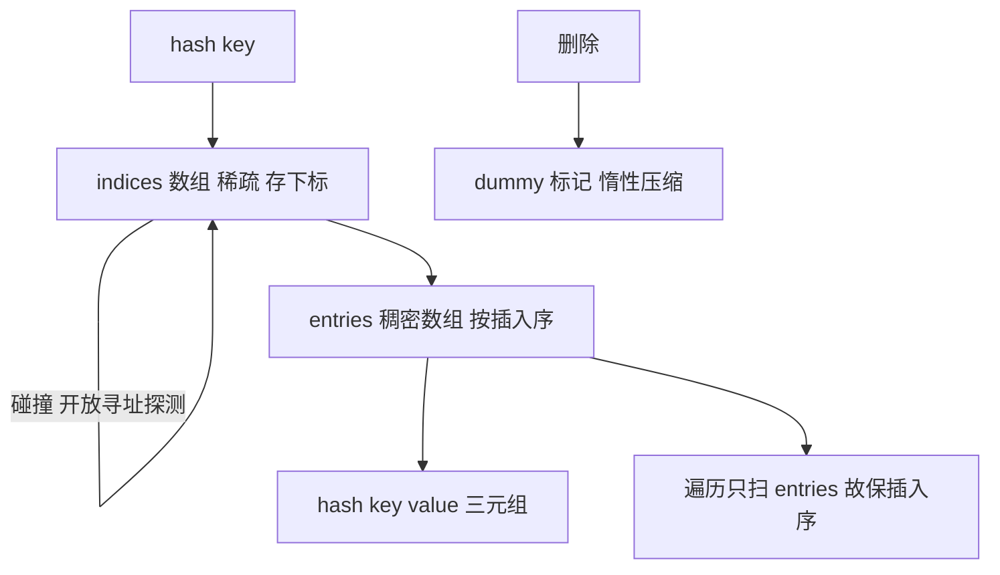

### Q426 · dict 紧凑布局与哈希碰撞:CPython 的表结构

> 难度:★★★★★ | 标签:dict, 哈希, 内存

**问**:CPython dict 的"compact"布局指什么?为什么 `list(d)` 的顺序和插入序一致而"理论哈希表"不该有顺序?哈希碰撞时开放寻址怎么工作?`sys.getsizeof` 为什么不能反映真实内存?

**答**:现代 CPython dict(3.6 起,设计讨论由 Raymond Hettinger 在 python-dev 发起、参考 PyPy 的实现,INADA Naoki 落地;无正式 PEP)把存储拆成两部分:一个稀疏的 `indices` 数组(存条目在 entries 数组里的下标,1/2/4/8 字节视表大小而定)+ 一个稠密的 `entries` 数组(按插入序排列 hash/key/value 三元组)。查找走 hash→indices→entries,碰撞用开放寻址(扰动序列探测),但**遍历只扫稠密 entries**,天然保持插入序——顺序是紧凑布局的副产品,不是规范承诺(语言规范在 3.7 正式追认)。碰撞率上升时探测链变长,最坏 O(n);`sys.getsizeof` 只算 dict 对象与表本身,不含 key/value 指向的对象,也不含共享键表的分摊,评估真实内存要靠 tracemalloc。删除采用 dummy 标记 + 惰性压缩,所以频繁增删的 dict 有内存驻留问题,必要时重建。

```python
# file: code/01_语言核心与底层/q426_dict_compact.py
import sys

d = {}
for k in ["z", "a", "m"]:
    d[k] = ord(k)
print("iteration order == insertion order:", list(d) == ["z", "a", "m"])

# 哈希与槽位:int 的 hash 是它自身,观察 index 数组稀疏性
i = hash("z")
print("hash('z') =", i, "mod 8 =", i % 8)

# 缩容不自动发生:大表删空后 sizeof 不降
big = {k: k for k in range(100_000)}
size_full = sys.getsizeof(big)
for k in list(big): del big[k]
print("full:", size_full, "after del all:", sys.getsizeof(big),
      "rebuilt:", sys.getsizeof(dict(big)))

# 碰撞演示:自定义对象 hash 恒定,强制全部撞进同一槽
class Collide:
    def __hash__(self): return 42
    def __eq__(self, other): return self is other

cd = {Collide(): i for i in range(5)}
print("collisions survived, len:", len(cd))
```

**追问**:1) `hash()` 恒定但 `__eq__` 不同为什么还要写?——演示碰撞;真实世界里应保证 `a == b` 蕴含 `hash(a) == hash(b)`,否则 dict 行为未定义。2) key-sharing dict(PEP 412)对什么生效?——只有 `__dict__` 且实例形状一致的普通类实例,`__slots__` 或动态加属性会脱离共享。


