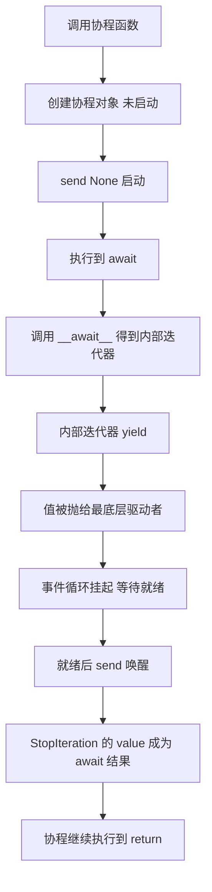

### Q440 · await 的本质:__await__ 协议与驱动者

> 难度:★★★★★ | 标签:协程, await

**问**:await 一个对象时,解释器到底做了什么?自己实现一个可等待对象要写什么?

**答**:await x 要求 x 可等待:原生协程、实现 `__await__` 且返回迭代器的对象、或被 types.coroutine 标记的生成器。执行时解释器取 `x.__await__()` 得到内部迭代器,然后像 yield from 一样驱动它:迭代器 yield 的值被转发给最底层驱动者(通常是事件循环),驱动者就绪后 send 回来,直到迭代器 StopIteration,其 value 成为 await 表达式的结果。asyncio.Future 的 __await__ 就是 `yield self`——把 Future 交给事件循环,完成时事件循环调 future.set_result 并 send 回协程。

```python
# file: code/01_语言核心与底层/q440_await_protocol.py
class SimpleFuture:
    """最小可等待对象:yield 一次交给驱动者,被唤醒后返回结果"""
    def __init__(self, done_value):
        self.done_value = done_value

    def __await__(self):
        woke = yield self             # 挂起:把这个对象抛给驱动者
        return woke or self.done_value

async def fetch():
    value = await SimpleFuture(42)
    return value * 2

if __name__ == "__main__":
    coro = fetch()
    yielded = coro.send(None)         # 拿到 yield 出的 SimpleFuture
    print("yielded to driver:", type(yielded).__name__)
    try:
        coro.send(100)                # 驱动者「就绪后」唤醒协程
    except StopIteration as stop:
        print("final:", stop.value)   # 200
```

**追问**:1) 事件循环 send 回来的值是怎么变成 Future.result 的?——Future.__await__ 里 yield self 之后紧跟 `return self.result()`,set_result 已经在 send 之前把 result 填好,所以 send(None) 返回值就是结果。2) 自定义可等待对象的要求清单?——__await__ 必须返回迭代器,解释器按 yield from 语义驱动它;返回非迭代器抛 TypeError,里面 yield 的对象必须被驱动者(事件循环)认识,否则任务永久挂起。3) await 的字节码序列?——3.10+ 编译为 GET_AWAITABLE → 循环 SEND → END_SEND;SEND 同时承担 next 与 send 两种恢复语义,与 yield from 共享实现,await 在静态层只是多了协程类型校验。4) 生产陷阱?——自研 Future 完成后不禁止二次 await,同一等待被消费两次;以及 yield 出事件循环不认识的对象(如裸数字)导致任务卡死且无报错,协议对象务必按 asyncio 的约定产出。


