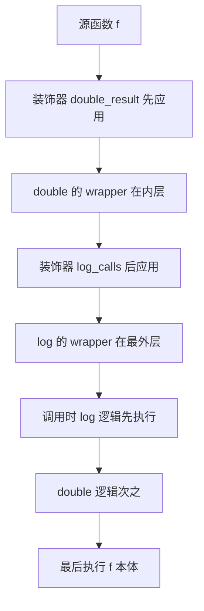

### Q447 · 装饰器与签名保留:__wrapped__ 与 unwrap

> 难度:★★★☆ | 标签:装饰器, inspect

**问**:多个装饰器叠加后,inspect.signature 为什么还能看到原函数签名?装饰器叠加的顺序规则是什么?

**答**:`@a @b @c def f` 等价于 `a(b(c(f)))`,列表下方的先应用、在最内层;调用时最外层(最上方)装饰器的逻辑先执行。functools.wraps 把原函数写入 wrapper 的 `__wrapped__` 属性,inspect.signature 默认沿这条链追踪到最内层取签名,traceback 模块也靠它显示原始文件行号;`inspect.unwrap` 可手动解链。没有 wraps 的装饰器会让签名变成 (*args, **kwargs)、文档丢失,这是调试困难和 IDE 补全失效的常见根因。

```python
# file: code/01_语言核心与底层/q447_wrapped_chain.py
import functools
import inspect

def log_calls(func):
    @functools.wraps(func)
    def wrapper(*args, **kwargs):
        print(f"log: calling {func.__name__}")
        result = func(*args, **kwargs)
        print(f"log: {func.__name__} returned {result}")
        return result
    return wrapper

def double_result(func):
    @functools.wraps(func)
    def wrapper(*args, **kwargs):
        return func(*args, **kwargs) * 2
    return wrapper

@log_calls
@double_result
def add(a, b=1):
    """add two numbers"""
    return a + b

if __name__ == "__main__":
    print(add(1, 2))                      # log 先执行,double 先算
    print(add.__name__, add.__doc__)      # wraps 保留的元信息
    print(inspect.signature(add))         # (a, b=1):沿 __wrapped__ 链还原
    f = add
    while hasattr(f, "__wrapped__"):
        f = f.__wrapped__
    print("unwrapped to original:", f is not None)
    print(inspect.unwrap(add) is not None)
```

**追问**:1) inspect.unwrap 怎么防死循环?——它检测 __wrapped__ 链上的重复对象(id 环),一旦成环就抛 ValueError,而不是无限解引用。2) 签名还原靠什么?——functools.wraps 把原函数写入 wrapper.__wrapped__,inspect.signature 默认沿链追踪到最内层;__name__/__doc__/__dict__ 也被拷贝,traceback 才能显示原始行号。3) 应用顺序与执行顺序为何相反?——`@a @b @c def f` 等价 a(b(c(f))),包裹从下往上,调用时最外层先执行;有依赖的装饰器(先鉴权后缓存)顺序写反是逻辑 bug,按「离 def 越近越先执行」读。4) 生产陷阱?——第三方装饰器漏 wraps,监控里所有调用聚合到 wrapper 名下失去可观测性;动态生成装饰器时把 __wrapped__ 指回自身成环,unwrap 抛 ValueError 而非死循环,要提前防御。


