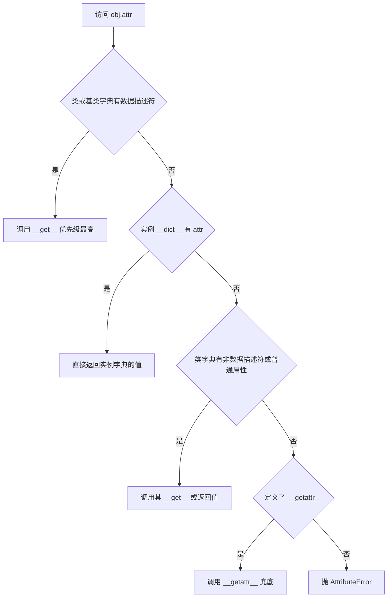

### Q453 · __set_name__:描述符的命名感知

> 难度:★★★☆ | 标签:描述符, 元编程

**问**:描述符怎么知道自己在类里叫什么名字?这个钩子在什么时机执行?

**答**:`__set_name__(owner, name)` 在类体执行完、type.__new__ 创建类对象时被调用,owner 是宿主类、name 是描述符被赋给的属性名,每个描述符实例只触发一次。有了名字,描述符就能自动生成对应的存储键、报错信息、SQL 列名等,免掉 `field = Typed(int, "field")` 这种重复。声明式框架(ORM 字段、校验字段)几乎都依赖它;类装饰器和 __init_subclass__ 是它失效时的兜底方案。

```python
# file: code/01_语言核心与底层/q453_set_name.py
class Column:
    """声明式字段:自动以属性名作为列名"""
    def __init__(self, coltype, colname=None):
        self.coltype = coltype
        self.colname = colname

    def __set_name__(self, owner, name):
        self.colname = self.colname or name
        owner._columns = getattr(owner, "_columns", ()) + (self,)

    def __get__(self, obj, objtype=None):
        if obj is None:
            return self
        return obj.__dict__.get(self.colname)

    def __set__(self, obj, value):
        if not isinstance(value, self.coltype):
            raise TypeError(f"{self.colname}: {self.coltype.__name__} required")
        obj.__dict__[self.colname] = value

class User:
    username = Column(str)
    age = Column(int, colname="user_age")

    def __init__(self, username, age):
        self.username = username
        self.age = age

if __name__ == "__main__":
    u = User("alice", 30)
    print(u.username, u.age)
    print("columns:", [c.colname for c in User._columns])
    try:
        u.age = "old"
    except TypeError as e:
        print("rejected:", e)
```

**追问**:1) 为什么继承体系的子类里定义的描述符也会触发 __set_name__?——它只在类创建时对「类体里直接定义」的描述符调用一次,继承来的描述符不会再触发,所以基于描述符的框架要处理子类覆盖问题。2) 调用时机为什么重要?——type.__new__ 创建类对象时同步调用,此时类体刚执行完、类还不完整,钩子里不能引用稍后定义的成员;跨类初始化要放 __init_subclass__。3) 谁负责调用它?——type.__new__ 遍历新类 __dict__,对实现 __set_name__ 的属性逐个调用;手动 type() 创建的类同样走这条路,元类继承链不改变行为。4) 生产陷阱?——描述符实例被多个字段共享(模块级单例),__set_name__ 只记最后一个名字,前面的字段全部错乱;每个字段声明必须新建描述符实例,这是 ORM 字段定义的铁律。


