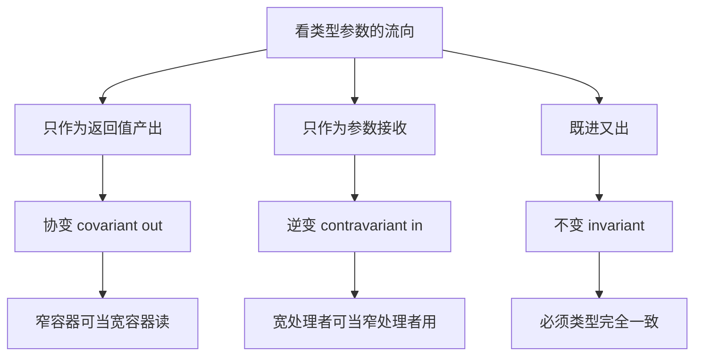

### Q460 · 协变与逆变:泛型的方向性

> 难度:★★★★★ | 标签:typing, 类型系统

**问**:Shelter[Dog] 能当 Shelter[Animal] 用吗?为什么 list 是不变 invariant 而容器协议可以协变?

**答**:取决于类型参数的流向:只产出 T(只读容器)可以协变 covariant——Dog 的容器当作 Animal 的容器读,读出的都是 Animal,安全;只接收 T(回调参数)可以逆变 contravariant——能喂 Animal 的 Feeder 当然能喂 Dog;又进又出的可变容器(list)必须不变 invariant,否则 `list[Dog]` 别名成 `list[Animal]` 后塞进 Cat,再按 Dog 读就崩了。TypeVar 的 covariant/contravariant 参数声明方向,静态检查器据此校验继承关系,写反了会在定义处报错。

```python
# file: code/01_语言核心与底层/q460_variance.py
from typing import Generic, TypeVar, Protocol

class Animal:
    def speak(self) -> str:
        return "..."

class Dog(Animal):
    def speak(self) -> str:
        return "woof"

T_co = TypeVar("T_co", covariant=True)               # 协变:只出不进
T_contra = TypeVar("T_contra", contravariant=True)   # 逆变:只进不出

class Shelter(Generic[T_co]):
    def __init__(self, animal: T_co) -> None:
        self.animal = animal

    def adopt(self) -> T_co:
        return self.animal

class Feeder(Protocol[T_contra]):
    def feed(self, animal: T_contra) -> None:
        """协议方法:能喂更宽的类型,就能喂更窄的类型"""

class AnimalFeeder:
    def feed(self, animal: Animal) -> None:
        print("fed", animal.speak())

if __name__ == "__main__":
    dog_shelter: Shelter[Dog] = Shelter(Dog())
    wider: Shelter[Animal] = dog_shelter   # 协变:Dog 容器可当 Animal 容器读
    print(wider.adopt().speak())

    feeder: Feeder[Dog] = AnimalFeeder()   # 逆变:能喂 Animal 就能喂 Dog
    feeder.feed(Dog())
```

**追问**:1) 为什么 Sequence 是协变的而 list 不是?——Sequence 只有读方法没有 append,数据只流出;list 有 append,数据双向流动,协变会破坏类型安全。2) 逆变在标准库哪里出现?——Callable 的参数位置逆变、返回位置协变:能处理更宽参数的函数才能赋给要求窄参数的变量,函数子类型关系由此定义。3) 可变容器为什么必须不变?——若 list[Dog] 可当 list[Animal],写路径 append(Cat) 会破坏读路径的类型假设;不变(invariant)把读写双向流一起锁死,错误在静态期暴露而非运行时崩溃。4) 生产陷阱?——把 covariant TypeVar 用在方法参数位置,mypy/pyright 直接报错;设计泛型协议要先画清类型参数的进出流向再标方向,方向标错要到检查期才发现。


