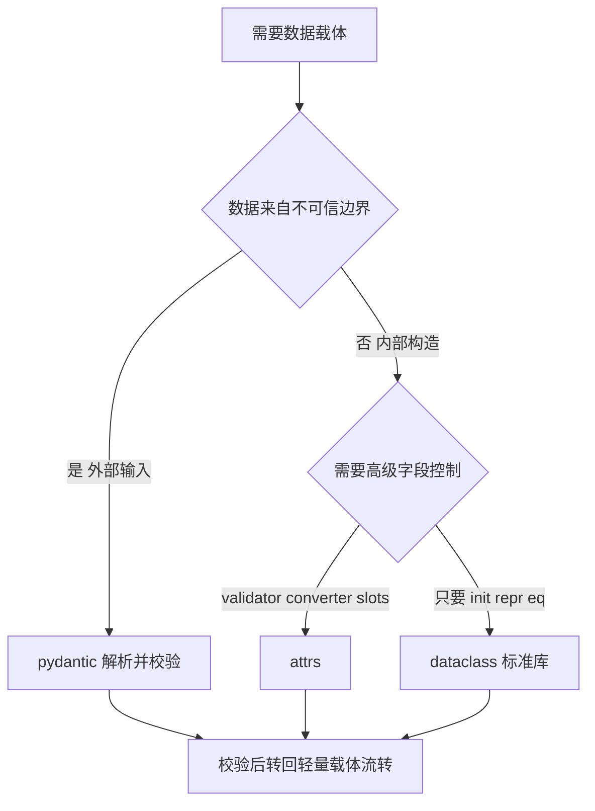

### Q467 · dataclass vs attrs vs pydantic 选型

> 难度:★★★★ | 标签:dataclass, attrs, pydantic

**问**:三个「数据类」方案怎么选?各自的运行时成本在哪里?

**答**:dataclass 是标准库的代码生成器:生成 __init__/__repr__/__eq__,零依赖、零校验,适合内部可信代码的数据载体。attrs 是功能超集:validator、converter、slots、frozen、自动 __hash__ 一应俱全,历史比 dataclass 久、生态成熟,适合需要精细字段控制又不想引重型依赖的项目。pydantic 是运行时验证层:把类型注解当校验规则在边界强制解析转换(字符串转日期、类型强制),代价是 CPU 与依赖体积。标准做法:外部不可信输入(配置、HTTP 请求)进 pydantic,通过后转成 dataclass/attrs 在内部流转,避免校验成本渗透到热路径。

```python
# file: code/01_语言核心与底层/q467_dataclass_vs_attrs.py
from dataclasses import dataclass, asdict

@dataclass
class Point:
    x: int
    y: int

@dataclass
class Port:
    """手写 attrs 风格校验:借 __post_init__"""
    number: int

    def __post_init__(self):
        if not (0 < self.number < 65536):
            raise ValueError(f"invalid port {self.number}")

if __name__ == "__main__":
    p = Point(1, 2)
    print(asdict(p))
    print(Point("a", None))               # dataclass 运行时不校验类型
    try:
        Port(70000)
    except ValueError as e:
        print("hand validation:", e)
```

**追问**:1) 为什么「边界校验、内部信任」是标准折中?——校验是 CPU 成本且对内部可信代码是噪音;边界一次付费换全链路放心,内部再用强类型传导不变式。2) pydantic v2 为什么快?——核心下沉 Rust(pydantic-core),校验与序列化在 Rust 层编译执行,常见模型比 v1 快数倍到数十倍;strict/lax 两模式的隐式转换规则要显式选择,避免静默强转。3) 三者的元信息载体?——dataclass 存 __dataclass_fields__,attrs 存 Attribute 列表,pydantic v2 编译出 core schema(Rust 校验计划);序列化、迁移、文档工具都从这些元信息出发。4) 生产陷阱?——pydantic 模型直接当内部载体到处传,校验成本渗透热路径,应在边界后转 dataclass/attrs;attrs 的 slots=True 类没有 __dict__,与 cached_property 等机制冲突。


