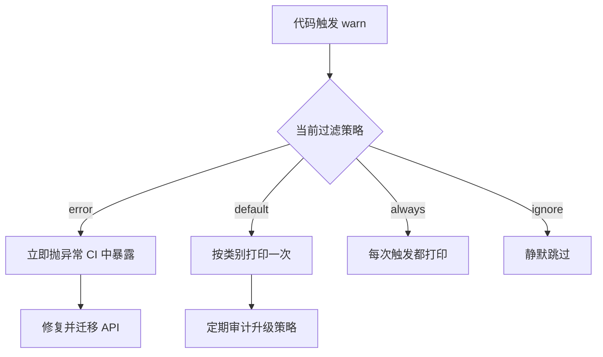

### Q471 · warnings 治理:过滤与升级为错误

> 难度:★★★☆ | 标签:warnings, 工程化

**问**:库作者的 DeprecationWarning 为什么用户常常「看不见」?如何把告警变成 CI 的硬失败?

**答**:warnings 有全局过滤器链,默认策略下 DeprecationWarning 只在 __main__ 模块显示(避免库的弃用告警淹没用户),且同一位置默认只告警一次(靠 __warningregistry__ 去重)。治理三板斧:库作者在自家测试里 `simplefilter("error", DeprecationWarning)` 把告警变异常,防止自己先违反;调用方用 -W error::DeprecationWarning 或 pytest 的 filterwarnings 在 CI 强制零告警;发布前用 catch_warnings(record=True) 收集全部告警做审计。deprecated 消息要写清替代方案与移除版本。

```python
# file: code/01_语言核心与底层/q471_warnings_governance.py
import warnings

def legacy_api():
    warnings.warn("legacy_api will be removed in 2.0, use new_api",
                  DeprecationWarning, stacklevel=2)
    return "old"

def risky():
    warnings.warn("disk almost full", ResourceWarning)

if __name__ == "__main__":
    # 库作者视角:开发期把告警升级为错误,防回归
    warnings.simplefilter("error", DeprecationWarning)
    try:
        legacy_api()
    except DeprecationWarning as e:
        print("as error:", e)
    warnings.simplefilter("default")

    # 调用方视角:收集并审计
    with warnings.catch_warnings(record=True) as caught:
        warnings.simplefilter("always")
        risky()
        legacy_api()
        for w in caught:
            print(f"[{w.category.__name__}] {w.message} at line {w.lineno}")

    warnings.filterwarnings("ignore", message=".*disk almost full.*")
    risky()                               # 被静默
    print("filtered ok")
```

**追问**:1) 为什么同一处告警默认只出现一次?——CPython 用模块的 __warningregistry__ 记录「已告警的位置」,重复触发直接跳过;测试里要多次触发需 simplefilter("always") 绕过注册表。2) 过滤器链的匹配顺序?——filterwarnings 把 (action, message, category, module, lineno) 前插到全局列表,先匹配先生效;最具体的规则要在最后插入(排最前),simplefilter 则整表重置。3) 注册表去重什么时候失效?——模块重载、__warningregistry__ 版本号变更、或 catch_warnings 上下文里 registry 被替换时重新告警;"always" action 直接绕过注册表,这也是测试的标配。4) 生产陷阱?——生产日志级别吞掉 warning,弃用信息没人看见,依赖升级时集中爆发;治理组合是「CI 里 -W error + 定期 record=True 全量审计 + 每条弃用写明替代 API 与移除版本」。


