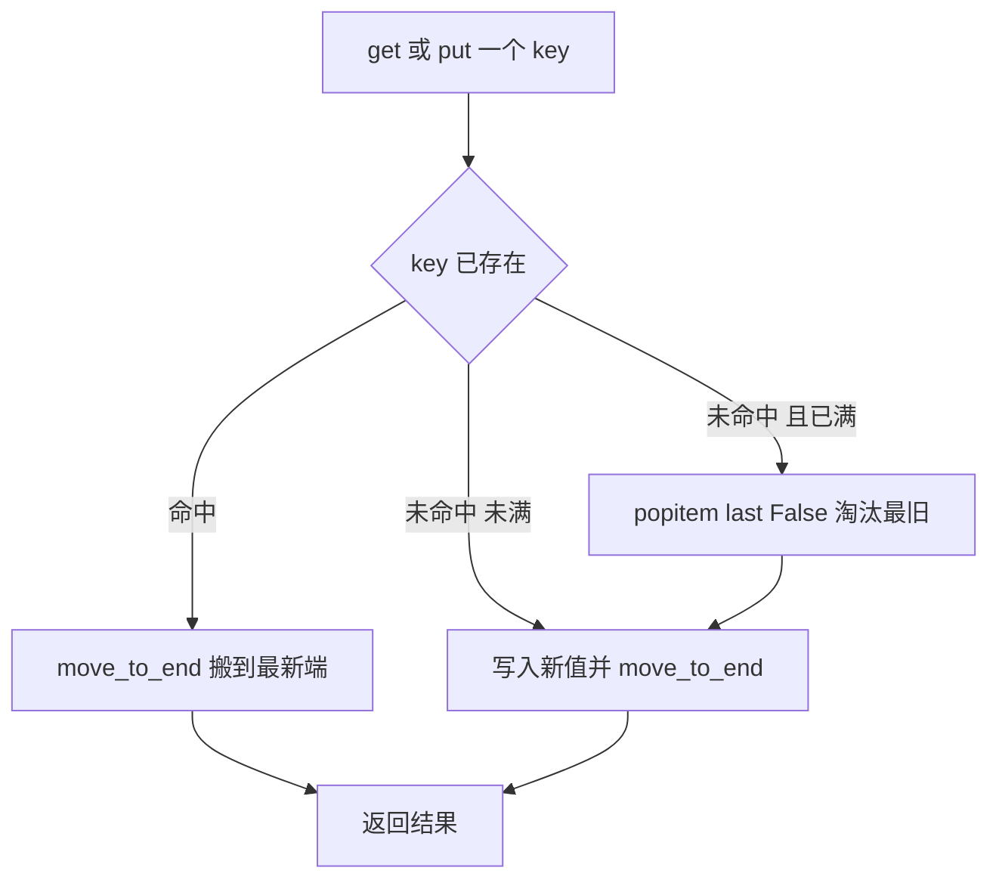

### Q478 · OrderedDict 与 LRU 实现

> 难度:★★★☆ | 标签:字典, OrderedDict

**问**:3.7 后普通 dict 也有序,OrderedDict 还剩什么不可替代的能力?

**答**:两件 dict 做不到的事:`move_to_end(key, last=True)` 把任意已有键搬到首/尾,`popitem(last=False)` 从头部弹出——这两个重排操作正好构成 LRU 的全部状态转移,所以手写 LRU 用 OrderedDict 十几行搞定。此外 OrderedDict 的相等比较是顺序敏感的(d1 == d2 要求同序),普通 dict 不看顺序。Functools 的 lru_cache 已内置但不可持久化、不可观测;需要「按访问重排」「顺序参与比较」的语义时 OrderedDict 仍是正解。

```python
# file: code/01_语言核心与底层/q478_ordereddict_lru.py
from collections import OrderedDict

class LRUCache:
    def __init__(self, capacity):
        self.cap = capacity
        self.data = OrderedDict()

    def get(self, key):
        if key not in self.data:
            return None
        self.data.move_to_end(key)            # 命中即最新
        return self.data[key]

    def put(self, key, value):
        if key in self.data:
            self.data.move_to_end(key)
        self.data[key] = value
        if len(self.data) > self.cap:
            self.data.popitem(last=False)     # 淘汰最旧

if __name__ == "__main__":
    cache = LRUCache(2)
    cache.put("a", 1)
    cache.put("b", 2)
    print(cache.get("a"))                     # a 变为最新
    cache.put("c", 3)                         # 超容:淘汰 b
    print("b evicted:", cache.get("b"))
    print("a kept:", cache.get("a"), "c:", cache.get("c"))
```

**追问**:1) 普通 dict 模拟 LRU 缺什么?——没有 O(1) 的重排:每次命中要 del 再重新插入,虽然摊还也快,但语义和可读性都不如 move_to_end 一行明确。2) OrderedDict 的额外成本?——为 O(1) move_to_end 维护双向链表,每键多两个指针的内存开销,遍历也稍慢;纯插入序场景普通 dict 更省,「访问即重排」的 LRU 才是 OrderedDict 主场。3) lru_cache 的 C 实现结构?——哈希表 + 双向循环链表:命中把节点搬到链表头,超 maxsize 淘汰尾部;cache_info 提供 hits/misses/maxsize/currsize,命中率是调参依据。4) 生产陷阱?——lru_cache(maxsize=None) 在长寿命进程里变成纯 memoization 只增不减;方法级 lru_cache 以 self 为参数会把实例钉死在缓存里造成泄漏,要用实例级缓存或弱引用包装。


