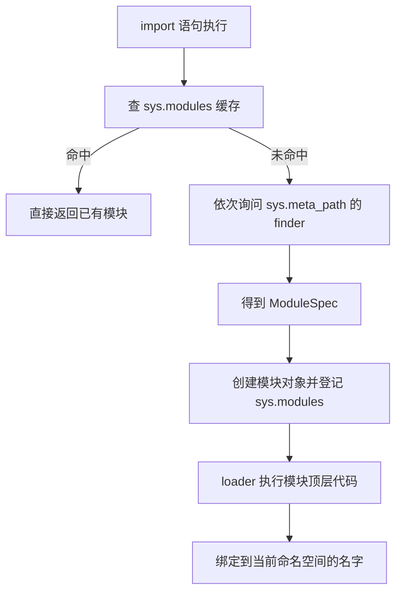

### Q482 · sys.meta_path:自定义导入拦截

> 难度:★★★★ | 标签:import, meta_path

**问**:如何在 import 层面禁止某些模块被加载?自定义 MetaPathFinder 要实现什么?

**答**:把自定义 finder 插到 sys.meta_path 最前面,实现 `find_spec(fullname, path, target)`:要拦截就抛 ImportError 或返回一个带 None loader 的 spec,放行就返回 None 让后续 finder 继续。这是实现导入白名单/黑名单、按需重定向模块、导入计数的标准机制;插件沙箱、冻结环境(禁用网络模块)都靠它。注意 finder 只在「sys.modules 未命中」时被询问,已导入的模块拦不住。

```python
# file: code/01_语言核心与底层/q482_meta_path_finder.py
import importlib.abc
import sys

BANNED = {"this"}          # 以 this 模块为例:策略禁止导入

class Blocker(importlib.abc.MetaPathFinder):
    def find_spec(self, fullname, path=None, target=None):
        root = fullname.split(".")[0]
        if root in BANNED:
            raise ImportError(f"{root} is banned by policy")
        return None                      # 放行:交给后续 finder

if __name__ == "__main__":
    sys.meta_path.insert(0, Blocker())
    import json                          # 正常模块不受影响
    print("json ok")
    try:
        import this                      # 被 finder 拦截
    except ImportError as e:
        print("blocked:", e)
    sys.meta_path.pop(0)
    print("finder removed")
```

**追问**:1) find_spec 抛 ImportError 和返回 None 的区别?——返回 None 是「我不管,问下一个 finder」;抛异常是「我管,且禁止导入」,异常直接冒给 import 语句。2) 为什么拦截放在 meta_path 而不是 sys.path_hooks?——meta_path finder 先于一切 path 查找执行,能拦截任意模块名(含内置),适合审计、重定向与沙箱;path_hooks 只作用于 sys.path 的路径条目。3) 导入的完整解析链?——先查 sys.modules 缓存,再按序执行 meta_path(BuiltinImporter→FrozenImporter→PathFinder)的 find_spec,全部 None 则 ModuleNotFoundError;命中后走 loader 完成 create/exec。4) 生产陷阱?——第三方 finder 异常中断整条导入链,要 fail-soft(except 后返回 None);用户代码把恶意 finder 插到 meta_path 头部即劫持全部 import。


