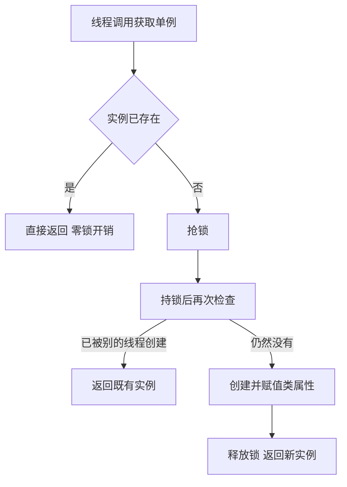

### Q489 · 线程安全单例:双检锁与模块级

> 难度:★★★★ | 标签:单例, 线程安全

**问**:多线程下的懒加载单例为什么需要两次检查实例是否为 None?模块级单例还需要加锁吗?

**答**:双检锁:第一次无锁检查是快路径(实例已存在时零开销),持锁后的第二次检查防止「两个线程都通过了第一次检查」时创建两个实例——第一次检查与赋值之间存在竞态窗口。Python 里还要注意赋值本身的原子性由 GIL 保证,但「检查+创建+赋值」是复合操作,必须整体置于锁内。模块级单例(直接放模块变量)导入时有 import 锁保护,天然安全,缺点是无法懒加载、不利于测试替换。要求严格按初始化顺序时,双检锁 + Barrier 测试验证。

```python
# file: code/01_语言核心与底层/q489_thread_safe_singleton.py
import threading

class Config:
    _instance = None
    _lock = threading.Lock()

    def __new__(cls):
        if cls._instance is None:            # 第一次检查:无锁快路径
            with cls._lock:                  # 只有一个线程能进来
                if cls._instance is None:    # 双检:防竞态重复创建
                    cls._instance = super().__new__(cls)
        return cls._instance

if __name__ == "__main__":
    results = []
    barrier = threading.Barrier(4)

    def worker():
        barrier.wait()                       # 4 线程同时起跑,放大竞态
        results.append(Config() is Config())

    threads = [threading.Thread(target=worker) for _ in range(4)]
    for t in threads:
        t.start()
    for t in threads:
        t.join()
    print("all same instance:", all(results), "checks:", len(results))
```

**追问**:1) CPython 里能不能省掉锁?——不能省双检,但可以换思路:依赖 GIL 的单条字节码原子性(如模块 import 时的初始化),或用 threading.once 式的 Event 门闩;语义上「锁住创建路径」最不依赖实现细节。2) 双检锁为什么必须两次检查?——第一次检查让已初始化后的调用走无锁快路径;进入锁后的第二次检查确认排队竞争者之前没人完成创建;少一次就会重复构造或白等。3) 可见性的底层边界?——CPython 在 GIL 下单条字节码原子、共享对象可见,但 check-then-act 是复合操作不保证;Java volatile 这类内存序语义在 Python 没有直接对应物,正确性必须靠锁。4) 生产陷阱?——构造带副作用(注册监听器)时双构造导致重复注册;async 代码误用 threading.Lock 阻塞事件循环,要换 asyncio.Lock;模块 import 路径本身串行,简单场景不需要双检。


