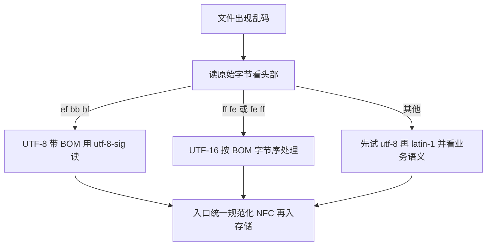

### Q492 · 编码实战:BOM 与 utf-8-sig

> 难度:★★★☆ | 标签:编码, UTF-8

**问**:读文件开头多了个 \ufeff 是什么?处理第三方来源的文件如何防编码事故?

**答**:\ufeff 是 UTF-8 BOM(字节 ef bb bf),Windows 工具(记事本、Excel 导出)常写入;用 utf-8 读会把它当普通字符留在内容开头,污染第一个字段(密钥比较失败、CSV 首列名对不上)。解法:读可能带 BOM 的文件用 `encoding="utf-8-sig"`(有 BOM 剥掉,没有也无害),写给 Windows 生态时也用它。更广的防事故原则:读写永远显式传 encoding(禁止依赖 locale 默认)、二进制模式读前 4 字节探测 BOM、乱码排查先看原始字节再谈解码。

```python
# file: code/01_语言核心与底层/q492_bom_encoding.py
import os
import tempfile

if __name__ == "__main__":
    text = "héllo"
    path = os.path.join(tempfile.mkdtemp(), "bom.txt")
    with open(path, "w", encoding="utf-8-sig") as f:   # 写入 BOM
        f.write(text)

    with open(path, "rb") as f:
        raw = f.read(10)
        print("raw head:", raw)                        # 开头是 ef bb bf

    with open(path, encoding="utf-8") as f:            # 忘记 -sig:BOM 留在内容里
        print("utf-8 sees:", repr(f.read()))

    with open(path, encoding="utf-8-sig") as f:        # 正确:BOM 被剥掉
        print("utf-8-sig sees:", repr(f.read()))
```

**追问**:1) UTF-16 的 BOM 有什么特殊性?——它还决定字节序:ff fe 是小端、fe ff 是大端,Python 的 utf-16 编解码器按 BOM 自动切换,跨平台交换文本时建议统一转 UTF-8。2) UTF-8 为什么也有 BOM?——U+FEFF 对 UTF-8 只是「签名」(EF BB BF),无字节序含义;Windows 工具爱加它,Python 用 utf-8 解码后文本首字符变成 \ufeff。3) 编解码器层怎么处理?——encoding="utf-8-sig" 解码剥 BOM、编码加 BOM;直接 utf-16 解码无 BOM 流会按大端猜;JSON 解析失败「意外字符」多半是 BOM 残留。4) 生产陷阱?——Excel 导出的 CSV 带 BOM,第一列名变成 "\ufeffid";HTTP 响应体误带 BOM 破坏前端解析;统一「读 utf-8-sig、写 utf-8」或对外一律 UTF-8 无 BOM。


