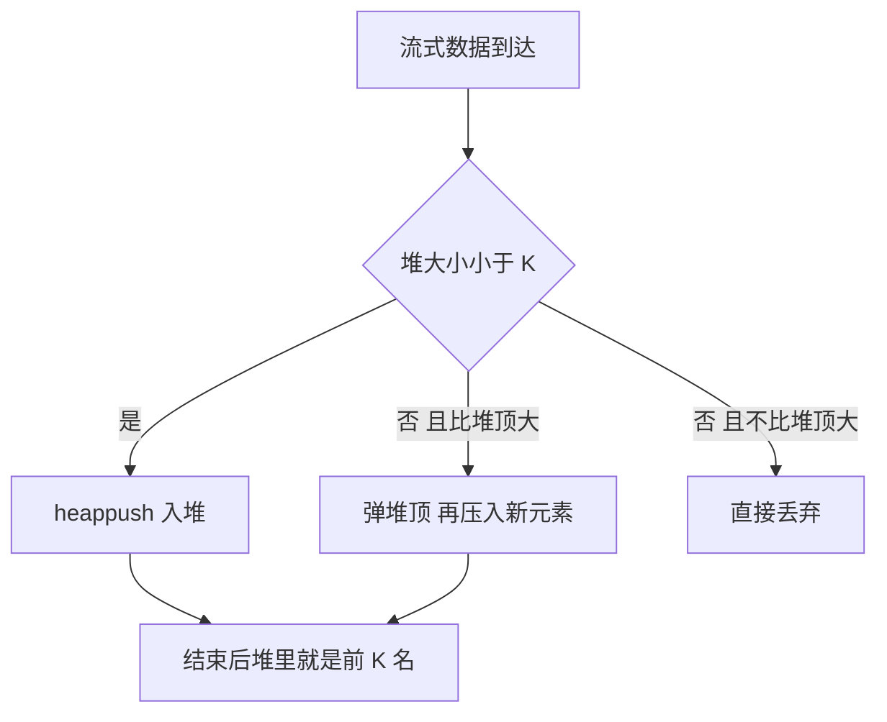

### Q495 · heapq:优先队列与 Top-K

> 难度:★★★☆ | 标签:heapq, 算法

**问**:Top-K 为什么用小顶堆而不是排序?元组元素入堆时怎么避免比较到第二个字段?

**答**:维护 K 大的小顶堆:新元素比堆顶大才替换,全程 O(n log k) 时空,且适合流式数据(不必一次性载入);全排序是 O(n log n) 且要全量内存。堆顶是最小值,「最差的随时出去」留下前 K 大。元组比较问题:(priority, payload) 优先级相同时会比较 payload,字符串比没问题但不可比对象直接 TypeError;标准解法加自增序号 (priority, seq, payload) 打破平局——seq 唯一,永远轮不到比较 payload,还天然 FIFO。

```python
# file: code/01_语言核心与底层/q495_heapq_topk.py
import heapq
import itertools

if __name__ == "__main__":
    data = [9, 1, 8, 2, 7, 3, 6, 4, 5]
    print("largest 3:", heapq.nlargest(3, data))
    print("smallest 3:", heapq.nsmallest(3, data))

    heap = []                             # 流式 Top-3:小顶堆
    for x in data:
        heapq.heappush(heap, x)
        if len(heap) > 3:
            heapq.heappop(heap)
    print("top3 via heap:", sorted(heap, reverse=True))

    counter = itertools.count()           # 打破元组平局
    tasks = [(2, next(counter), "low"), (1, next(counter), "urgent"),
             (1, next(counter), "urgent2")]
    heapq.heapify(tasks)
    while tasks:
        print("run", heapq.heappop(tasks)[2])
```

**追问**:1) heapq 是线程安全的吗?——不是,堆只是列表上的算法约定;并发生产者消费者要用 queue.PriorityQueue(内部封装了锁与完成通知)。2) 为什么用数组不用树节点?——完全二叉堆映射到连续数组(i 与 2i+1/2i+2),缓存友好、无指针开销;siftup/siftdown 是 C 实现,nlargest/nsmallest 还做了 top-k 特化。3) heapreplace 与 pop+push 的差别?——heapreplace 先弹后推融合为一次调整,少一半比较且临时大小不变;heapq 是最小堆,最大堆用负号或 (key, counter, item) 技巧。4) 生产陷阱?——推入不可比对象(dict)TypeError,要用 (priority, count, item) 加自增计数器决胜且保证稳定;推入后修改元素优先级造成堆不变式被破坏——必须取出重推。


