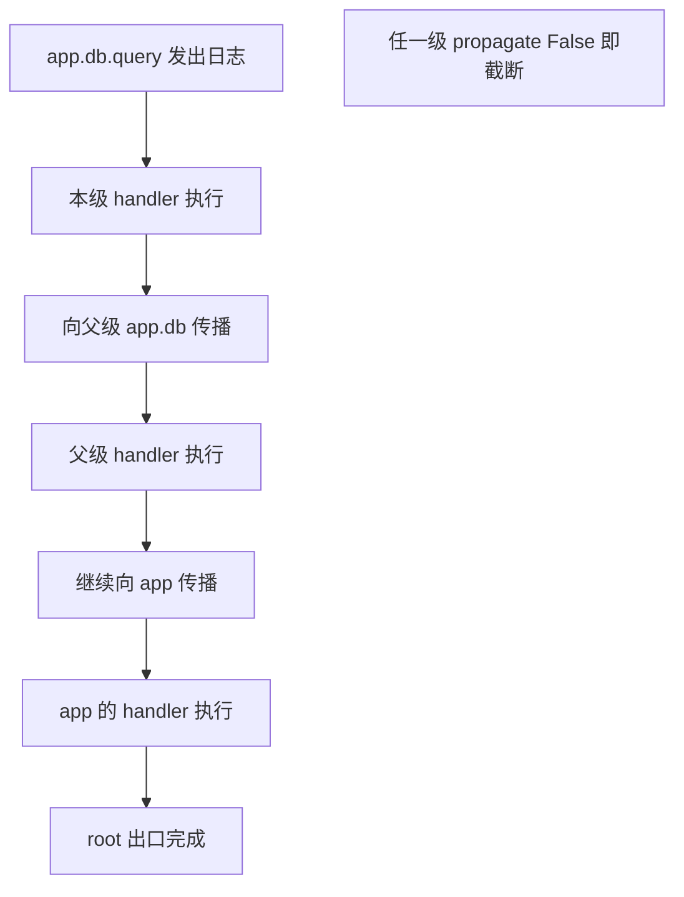

### Q502 · logger 层级与 propagate:重复日志的根源

> 难度:★★★★ | 标签:logging, 层级

**问**:为什么同一条日志打印了两次?logger 的层级传播机制到底怎么工作?

**答**:logger 按点分名字形成树(app → app.db → app.db.query):一条记录在自己这一级处理后,沿树向上一路传播,每一级都把「自己挂的 handlers」执行一遍,直到 propagate=False 或到达根。重复的经典原因:子 logger 与根(或父级)各挂了同一个/等效 handler,于是同一条记录被执行两次。治理规则:handler 只挂在根(或明确的出口层),子级只负责级别与 propagate;需要「这一级单独落盘」时关掉该级 propagate 再挂自己的 handler。effectiveLevel/getEffectiveLevel 可查某级的生效级别。

```python
# file: code/01_语言核心与底层/q502_logger_propagation.py
import logging

root = logging.getLogger("app")
child = logging.getLogger("app.db")
grand = logging.getLogger("app.db.query")

for lg in (root, child, grand):
    lg.handlers.clear()
    lg.setLevel(logging.INFO)
    lg.propagate = True

handler = logging.StreamHandler()
handler.setFormatter(logging.Formatter("%(name)s: %(message)s"))

if __name__ == "__main__":
    root.addHandler(handler)              # handler 只挂出口层
    grand.info("propagates to root once")

    child.addHandler(handler)             # 反面教材:父子挂同一 handler
    child.info("now printed twice")
    child.propagate = False
    child.info("cut off: printed once")
```

**追问**:1) record 是怎么带着「原始 logger 名」一路向上的?——LogRecord 在产生时就固化了 name 与调用信息,传播只是让祖先的 handlers 处理同一条 record,所以格式串里看到的永远是发起者。2) 重复日志的经典成因?——层级上多个 logger 各挂 handler 且 propagate 默认 True,同一 record 被多次输出;正解是只在 root 配 handler,或业务 logger 设 propagate=False。3) callHandlers 的底层机制?——从发起者沿层级向上逐层调 handlers(不看各层 level,只挑 handler 的 level),直到 propagate=False 停止;isEnabledFor 用的 effective level 在此之前已决定 record 是否产生。4) 生产陷阱?——每个模块自配 FileHandler 导致一行日志 N 份;子 logger setLevel 以为生效但被父级 effective level 管着;传播「恰好路过」三方 logger,库升级改层级结构后日志丢失。


