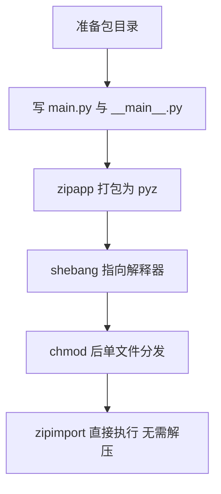

### Q507 · zipapp:打包为可执行归档

> 难度:★★★☆ | 标签:zipapp, 分发

**问**:不装依赖管理工具,如何把一个纯标准库工具变成「单文件、可执行、可直接跑」?

**答**:zipapp 把目录(或整个应用)打成 .pyz:本质是 zip 包,Python 能直接执行其中 __main__.py;`python -m zipapp src -o tool.pyz -m "main:main"` 还会写 shebang 并把入口设为 main.main,chmod 后 ./tool.pyz 直接运行。zipimport 负责从归档导入模块,无需解压。适用:内部 CLI 工具分发、不依赖三方库的运维脚本;限制:三方依赖要一起塞进包内(vendoring)或配合 pip target,C 扩展模块无法进 zipimport。配合 stdlib-only 原则,zipapp 是最轻的「绿色分发」。

```python
# file: code/01_语言核心与底层/q507_zipapp.py
import os
import subprocess
import sys
import tempfile
import zipfile

MAIN_PY = 'def main():\n    print("zipapp is running")\n'
ENTRY_PY = "from main import main\nmain()\n"

def build_app(srcdir, target):
    with open(os.path.join(srcdir, "main.py"), "w", encoding="utf-8") as f:
        f.write(MAIN_PY)
    with open(os.path.join(srcdir, "__main__.py"), "w", encoding="utf-8") as f:
        f.write(ENTRY_PY)
    with zipfile.ZipFile(target, "w") as zf:      # 等价于 python -m zipapp
        for name in ("__main__.py", "main.py"):
            zf.write(os.path.join(srcdir, name), name)

if __name__ == "__main__":
    src = tempfile.mkdtemp()
    out = os.path.join(src, "tool.pyz")
    build_app(src, out)
    print("built:", out, os.path.getsize(out), "bytes")

    result = subprocess.run([sys.executable, out], capture_output=True, text=True)
    print("run:", result.stdout.strip())
```

**追问**:1) .pyz 里怎么带三方依赖?——把 wheel 解包后的纯 Python 包目录一并打进去(vendoring);C 扩展不行,zipimport 无法加载 .so,那类项目要 Wheel 或 PyInstaller。2) zipapp 的运行机制?——zipimport 直接从归档加载模块:入口 main.py 加 shebang 行,sys.path 指向归档;.pyz 支持 deflate 压缩,.pyc 预编译可内嵌省去运行时编译。3) 底层加载链?——zipimporter 挂在 sys.path_hooks,按 zip 条目解析 spec;动态库要真实文件路径,所以 C 扩展必须解包到磁盘——这就是限制的根源。4) 生产陷阱?——shebang 缺失导致 ./app.pyz 不能直跑;归档内相对导入与包结构不符;带 C 扩展的项目误选 zipapp,运行时 ModuleNotFoundError。


