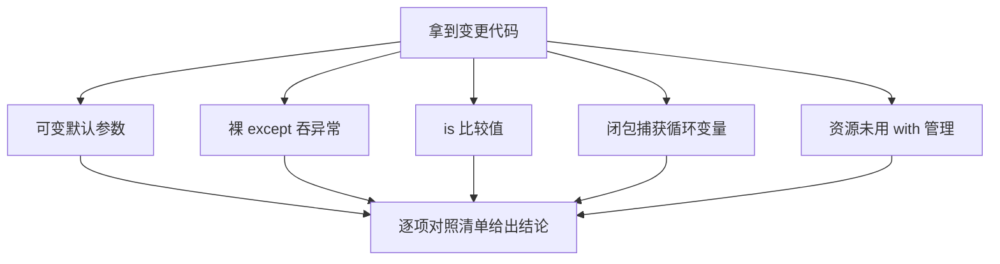

### Q511 · 代码评审:语言层 bug 清单

> 难度:★★★★ | 标签:评审, bug 模式

**问**:评审 Python 代码时,有哪些反复出现的语言层 bug 值得做成 checklist?

**答**:高频清单:1) 可变默认参数(跨调用累积);2) 裸 except / except Exception 吞掉 KeyboardInterrupt 或掩盖错误;3) is 比较值(字符串、数字);4) 在循环里改正在迭代的容器(跳元素或 RuntimeError);5) 闭包 late binding(lambda 捕获循环变量);6) 忘 close 的资源(用 with);7) 默认可变对象从入参逃逸(构造后存储同一引用);8) 修改入参但文档没说(调用方被坑);9) timezone-naive datetime 互相比;10) assert 做校验(-O 失效)。这份清单的前五条都能被静态工具部分捕获,评审时重点是工具报不了的「语义正确性」。

```python
# file: code/01_语言核心与底层/q511_review_bugs.py
def bug1_mutable_default(items=[]):
    items.append(1)
    return items

def bug2_is_vs_eq(a, b):
    return (a + b) is (a + b)             # 两次拼接是不同对象:不要用 is 比内容

def bug3_swallow():
    try:
        return int("x")
    except Exception:                     # 裸捕且不记录:错误静默丢失
        return None

def bug4_escaped_input(box=None):
    box = box if box is not None else {}
    box.setdefault("k", []).append(1)
    return box

if __name__ == "__main__":
    print(bug1_mutable_default(), bug1_mutable_default())
    print("is vs eq:", bug2_is_vs_eq("ab", ""))
    print("swallowed:", bug3_swallow())
    print(bug4_escaped_input(), bug4_escaped_input())
```

**追问**:1) 怎么让 checklist 不流于形式?——把可自动化的条目做成 lint 自定义规则(ruff/ast),评审清单只留人工项;每次评审发现的通用问题反哺工具,清单越用越短。2) 语言层 bug 清单该有哪些?——可变默认参数、闭包晚绑定、is 与 == 混用、裸 except 吞 KeyboardInterrupt、str/bytes 混拼、== None、解包前不验长度、GIL 想当然、async 函数忘 await、datetime naive 混用——每条都有确定报错模式,适合工具化。3) 评审的分工机制?——机器查语法与模式,人查设计与语义;评审注意力是稀缺资源,清单长 = 全部滑过,所以「工具项清零」是清单可用性的前提。4) 生产陷阱?——评审意见修完没有回归测试钉住,同类 bug 复发;风格讨论挤占逻辑讨论时间;新人照清单背条目却不懂每条背后的失败模式。


