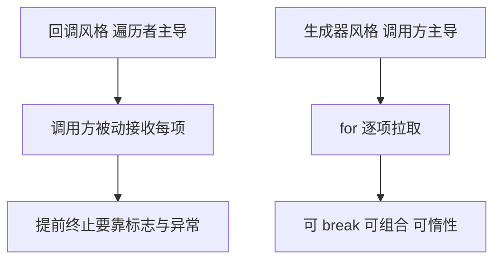

### Q523 · 回调重构为生成器:控制反转

> 难度:★★★☆ | 标签:重构, 生成器

**问**:回调风格的遍历(callback + visit)为什么难用?改造成生成器能获得什么?

**答**:回调风格是「遍历者主导」:控制权在被调方,调用方只能被动接收每项,想提前终止要在回调里加状态标志并抛异常打断栈,组合两个遍历(过滤+映射)要层层回调。生成器版本把控制权反转回调用方:yield 逐项拉取,调用方用 for、break、管道组合自由消费,还天然惰性。重构手法:把 visit(data) 调用点改为 yield data,递归结构用 yield from 串联,函数从「接收回调」变成「产出迭代器」,签名更简单、测试更直接(直接 list(gen) 断言)。这也是把 asyncio 回调链升级为 async/await 的同构思路。

```python
# file: code/01_语言核心与底层/q523_callback_to_generator.py
def walk_callback(node, visit):
    """回调风格:控制权在遍历者手里"""
    visit(node["name"])
    for child in node.get("children", []):
        walk_callback(child, visit)

def walk_generator(node):
    """生成器风格:控制权交还调用方"""
    yield node["name"]
    for child in node.get("children", []):
        yield from walk_generator(child)

TREE = {"name": "root", "children": [
    {"name": "a", "children": [{"name": "a1"}]},
    {"name": "b"},
]}

if __name__ == "__main__":
    names = []
    walk_callback(TREE, names.append)
    print("callback:", names)

    gen = walk_generator(TREE)
    print("lazy next:", next(gen), next(gen))

    for name in walk_generator(TREE):
        if name == "a1":
            break                             # 调用方可提前终止
        print("visited:", name)
```

**追问**:1) 什么情况下回调仍是正解?——事件是「推送」语义(不定次、不定时,如信号、GUI 事件)时回调自然;遍历是「拉取」语义,适合生成器;硬套会写出别扭的回调版生成器。2) 控制反转的本质差异?——回调:被调方在未知时刻调回调用方(推),控制流破碎、状态要显式管理;生成器:调用方主动拉(拉),流程线性,异常与清理走 try/finally 天然成立。3) 底层机制?——生成器 yield 挂起/恢复帧,消费方就是调度器;回调版本要维护标志、计数等隐式状态机,复杂度显性转移到代码里。4) 生产陷阱?——回调共享状态在并发下要加锁;生成器「定义了没消费」资源悬空(依赖 GC 调 aclose);为了统一而把推送语义事件硬改成拉取,反而扭曲设计——按数据流向选型。


